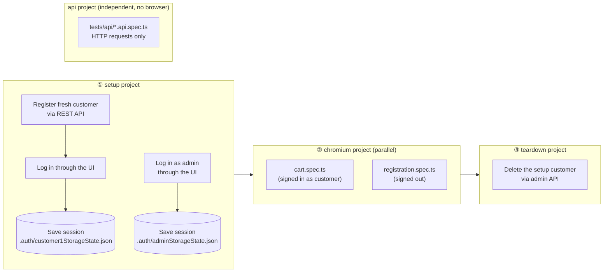
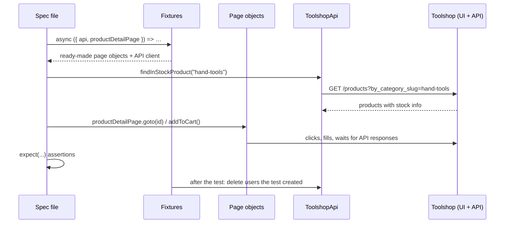
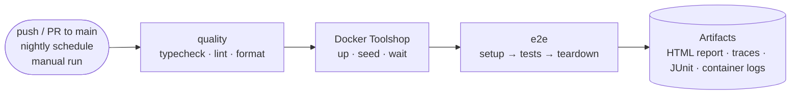

# Toolshop E2E Test Framework

[](https://github.com/hathihuyen/ecom-test-project-playwright/actions/workflows/playwright.yml)


End-to-end test automation for the [Practice Software Testing – Toolshop](https://practicesoftwaretesting.com), a demo e-commerce web shop, built with **Playwright** and **TypeScript**.

It covers the customer journey end to end: **registration, login, cart and a full checkout** (cart → address → payment → invoice) with all five payment methods. A separate **API contract suite** checks the REST endpoints for `/products`, `/carts` and `/users` directly, without a browser: status codes, response shapes (validated with [zod](https://zod.dev) schemas) and access rules.

The framework tests the **UI** like a real customer would. It uses the shop's **REST API** to prepare and clean up test data quickly and reliably. Each test run creates its own user accounts and data and deletes them afterwards. Shared demo accounts, product stock or leftover state from earlier runs can't make it fail.

The same suite runs against two targets with no code changes:

- the **public live site**, the default for quick local runs, or
- a **private copy of the Toolshop in Docker**, used by CI and available locally. It has no bot protection, no scheduled data resets and no other users.

---

## Table of contents

1. [Highlights](#highlights)
2. [Tech stack](#tech-stack)
3. [Quick start](#quick-start)
4. [Test environments: live site vs Docker](#test-environments-live-site-vs-docker)
5. [Running tests](#running-tests)
6. [How it works](#how-it-works)
7. [Project structure](#project-structure)
8. [Architecture & design decisions](#architecture--design-decisions)
9. [Test coverage](#test-coverage)
10. [Checkout flow](#checkout-flow)
11. [API contract tests](#api-contract-tests)
12. [Known application bugs](#known-application-bugs)
13. [Data-driven tests](#data-driven-tests)
14. [Writing a new test](#writing-a-new-test)
15. [Conventions](#conventions)
16. [Reports & debugging](#reports--debugging)
17. [Continuous integration](#continuous-integration)
18. [Configuration reference](#configuration-reference)
19. [Troubleshooting](#troubleshooting)
20. [Roadmap](#roadmap)

---

## Highlights

|                                    |                                                                                                                                  |
| ---------------------------------- | -------------------------------------------------------------------------------------------------------------------------------- |
| **Page Object Model + components** | Pages hold locators and user actions. Shared UI such as the nav bar is a reusable component.                                     |
| **Enum-based locators**            | Every `data-test` id lives in an `enum` at the top of its page file. Constructors never contain string literals.                 |
| **Data-driven tests**              | Test cases are typed data arrays (`data/*.data.ts`). Adding a case means adding one object, with no new test code.               |
| **Full purchase flow**             | One test per payment method walks cart → address → payment → invoice and checks the invoice the customer sees afterwards.        |
| **API contract tests**             | 24 browser-free tests check status codes, JSON shapes (zod schemas) and who may call what. The whole suite runs in seconds.      |
| **Known-bug tests**                | Real app bugs are pinned with `test.fail()` + a `bug` annotation. They turn red the moment the bug is fixed, so you notice.      |
| **Custom fixtures**                | Tests ask for `registrationPage`, `api` and so on, and get ready-to-use objects. Nothing needs `new` inside a test.              |
| **API-first test data**            | Users are created through the REST API in about a second. The UI is used only for the behaviour under test.                      |
| **Self-cleaning**                  | Every user a test creates is deleted afterwards, by a fixture or by a teardown project. Cleanup never fails a run.               |
| **Login once, reuse everywhere**   | A `setup` project logs in once and saves the session. All tests start already signed in.                                         |
| **Isolated runs**                  | Each run uses a fresh customer account, so lockouts and database resets on the shared demo site can't break it.                  |
| **Self-contained CI**              | CI starts its own Toolshop in Docker (pinned to app version 2.5), seeds it, and tests that copy rather than the public internet. |
| **Resilient to live data**         | Products are chosen at runtime by asking the API what is in stock. No hard-coded ids or names.                                   |
| **Typed end to end**               | Strict TypeScript, a shared `User` model, typed page objects and typed environment config.                                       |
| **Tag-based suites**               | `@smoke`, `@regression`, `@negative`, `@edge`, `@known-bug` and `@stress` let you run exactly the subset you need.               |
| **Quality gates**                  | Type check, ESLint (including Playwright rules and missing-`await` detection) and Prettier run in CI before any test.            |
| **Rich failure evidence**          | Each failed test keeps a trace, a video and a screenshot. CI also saves JUnit results, GitHub annotations and container logs.    |

---

## Tech stack

| Tool                                                                                                                                                                            | Purpose                                                |
| ------------------------------------------------------------------------------------------------------------------------------------------------------------------------------- | ------------------------------------------------------ |
| [Playwright Test](https://playwright.dev)                                                                                                                                       | Test runner, browser automation, API requests, tracing |
| [TypeScript](https://www.typescriptlang.org)                                                                                                                                    | Static typing (strict mode), path aliases              |
| [Faker.js](https://fakerjs.dev)                                                                                                                                                 | Realistic random test data                             |
| [zod](https://zod.dev)                                                                                                                                                          | Response schemas for the API contract tests            |
| [dotenv](https://github.com/motdotla/dotenv)                                                                                                                                    | Loads `.env` files per environment                     |
| [ESLint](https://eslint.org) + [typescript-eslint](https://typescript-eslint.io) + [eslint-plugin-playwright](https://github.com/playwright-community/eslint-plugin-playwright) | Static analysis and Playwright best practices          |
| [Prettier](https://prettier.io)                                                                                                                                                 | Consistent code formatting                             |
| [Docker Compose](https://docs.docker.com/compose/)                                                                                                                              | Private Toolshop instance for CI and local runs        |
| [GitHub Actions](https://docs.github.com/actions)                                                                                                                               | CI pipeline                                            |

---

## Quick start

### Prerequisites

- **Node.js 22+**. The version is pinned in [`.nvmrc`](.nvmrc); with nvm, run `nvm use`.
- **Git**
- Admin credentials for the Toolshop. They're published in the [Toolshop documentation](https://testsmith-io.github.io/practice-software-testing/#/).
- _Optional:_ **Docker** with the Compose and buildx plugins, to run the private Toolshop copy (see [Test environments](#test-environments-live-site-vs-docker)).

### 1. Install

```bash
git clone https://github.com/hathihuyen/ecom-test-project-playwright.git
cd ecom-test-project-playwright
npm ci                                  # exact versions from package-lock.json
npx playwright install --with-deps chromium
```

### 2. Configure

```bash
cp .env.example .env
```

Then fill in `.env`:

```dotenv
BASE_URL=https://practicesoftwaretesting.com
API_URL=https://api.practicesoftwaretesting.com
ADMIN_EMAIL=<admin email>
ADMIN_PASSWORD=<admin password>
```

> `.env` is git-ignored and must never be committed. You don't need customer credentials, because the framework creates its own customer on every run.

### 3. Run

```bash
npm test               # full suite against the live site
npm run report         # open the HTML report
```

To run against the private Docker copy instead, see the next section.

---

## Test environments: live site vs Docker

|                                     | Live site (default locally)                  | Docker copy (CI, optional locally)                        |
| ----------------------------------- | -------------------------------------------- | --------------------------------------------------------- |
| URLs                                | `practicesoftwaretesting.com` / `api.…`      | `http://localhost:4200` / `http://localhost:8091`         |
| Cloudflare bot check                | Yes. **Blocks CI runners** (data-centre IPs) | None                                                      |
| Data resets                         | On the hour, several times a day             | Never during a run (the reset `cron` service is left out) |
| Other users changing stock/accounts | Yes                                          | No. Fresh seed data each time                             |
| Occasional slow or stalled pages    | Yes                                          | No                                                        |
| Setup needed                        | `.env` only                                  | Docker + `.env.docker`                                    |

**Use the Docker copy** for anything that must be reliable (CI, before a merge, debugging a flaky test). Use the live site for a quick check, for example `npm run test:smoke`.

### Running against the Docker copy locally

**One-time setup (Ubuntu):**

```bash
sudo apt install -y docker.io docker-compose-v2 docker-buildx
sudo usermod -aG docker $USER      # then log out of the desktop session and back in
```

Create `.env.docker` (git-ignored by the `.env.*` rule). These are the default accounts the Docker copy creates:

```dotenv
BASE_URL=http://localhost:4200
API_URL=http://localhost:8091
ADMIN_EMAIL=admin@practicesoftwaretesting.com
ADMIN_PASSWORD=welcome01
```

**Every session:**

```bash
npm run toolshop:up            # start the containers (first time: a few minutes to download ~1.5 GB)
sleep 30                       # give MariaDB time to start
npm run toolshop:seed          # create tables + demo data
TEST_ENV=docker npm test       # TEST_ENV=docker loads .env.docker
npm run toolshop:down          # stop and remove everything, including data
```

### What's in `docker/`

| File                                                         | Purpose                                                                                                                                                          |
| ------------------------------------------------------------ | ---------------------------------------------------------------------------------------------------------------------------------------------------------------- |
| [`docker/toolshop-compose.yml`](docker/toolshop-compose.yml) | Based on the Toolshop's own `docker-compose.prod.yml`, with app images pinned to **2.5** and the data-resetting `cron` service removed                           |
| [`docker/web/Dockerfile`](docker/web/Dockerfile)             | Builds the nginx gateway locally. The published `practice-software-testing-web` image only exists for **arm64**, so it can't run on x86_64 PCs or GitHub runners |
| [`docker/web/vhost.conf`](docker/web/vhost.conf)             | nginx config from the Toolshop repo: forwards API requests on port 8091 to the Laravel API                                                                       |

| Container     | Image                                                 | Port               |
| ------------- | ----------------------------------------------------- | ------------------ |
| `angular-ui`  | `testsmith/practice-software-testing-sprint5-ui:2.5`  | `4200` (web shop)  |
| `web`         | built from `docker/web/` (nginx)                      | `8091` (REST API)  |
| `laravel-api` | `testsmith/practice-software-testing-sprint5-api:2.5` | internal (PHP-FPM) |
| `mariadb`     | `yobasystems/alpine-mariadb:10.6.11`                  | `3306`             |

---

## Running tests

### npm scripts

| Command                           | What it does                                                     |
| --------------------------------- | ---------------------------------------------------------------- |
| `npm test`                        | Run the full suite (setup → tests → teardown)                    |
| `npm run test:smoke`              | Only tests tagged `@smoke`, a fast confidence check              |
| `npm run test:regression`         | Only tests tagged `@regression`                                  |
| `npm run test:stress`             | The opt-in concurrency test (`@stress`), in its own project      |
| `npm run test:login`              | Only the login suite (`tests/e2e/login.spec.ts`)                 |
| `npm run test:checkout`           | Only the checkout suite (`tests/e2e/checkout.spec.ts`)           |
| `npm run test:api`                | Only the API contract tests (`tests/api/`), no browser, no setup |
| `npm run test:headed`             | Run with a visible browser window                                |
| `npm run test:ui`                 | Playwright **UI mode**: watch, time-travel, re-run single tests  |
| `npm run test:debug`              | Step through a test with the Playwright Inspector                |
| `npm run report`                  | Open the last HTML report                                        |
| `npm run typecheck`               | TypeScript type check (`tsc --noEmit`)                           |
| `npm run lint` / `lint:fix`       | ESLint, optionally auto-fixing                                   |
| `npm run format` / `format:check` | Prettier write / verify                                          |
| `npm run toolshop:up`             | Start the private Toolshop in Docker (builds `web` if needed)    |
| `npm run toolshop:seed`           | Create the Docker Toolshop's database tables and demo data       |
| `npm run toolshop:down`           | Stop the Docker Toolshop and delete its data                     |

### Useful Playwright CLI options

```bash
npx playwright test tests/e2e/cart.spec.ts            # one file
npx playwright test -g "validation errors"            # tests whose title matches
npx playwright test --grep @negative                  # only negative tests (also: @edge, @smoke, …)
npx playwright test --grep @known-bug                 # only the tests that pin known app bugs
npx playwright test --grep-invert @known-bug          # everything except the known-bug tests
npx playwright test --repeat-each=5                   # hunt for flaky tests
npx playwright test --project=setup                   # only the login setup
npx playwright test --project=api --grep @negative    # only the negative API tests
npx playwright test tests/api/carts.api.spec.ts       # one API spec
npx playwright test --list                            # list tests without running them
TEST_ENV=docker npx playwright test                   # use .env.docker (the Docker Toolshop)
ALL_BROWSERS=1 npx playwright test                    # add Firefox and WebKit projects
```

---

## How it works

### Test run lifecycle

Playwright **projects** are chained with dependencies, so every run follows the same lifecycle:



1. **`setup`** ([`tests/setup/auth.setup.ts`](tests/setup/auth.setup.ts)) runs first, once per run.
    - It **registers a brand-new customer through the API**, logs in through the real login form and saves the browser session (the auth token in `localStorage`) to `.auth/customer1StorageState.json`.
    - It logs in as the **admin** and saves that session too.
    - Logins use `LoginPage.loginAs()`. If the site rejects a login, the error contains the site's own message (for example _"Account locked…"_), not a generic timeout.
2. **`chromium`** runs the specs in parallel. Each test starts **already signed in as the customer**, because the project's `storageState` points at the saved session. Specs that need a signed-out browser (registration) override this with an empty storage state.
3. **`teardown`** ([`tests/setup/global.teardown.ts`](tests/setup/global.teardown.ts)) runs after all tests have finished and deletes the setup customer through the admin API. It is **best-effort**: if the delete fails (for example because the live site's database is being reset), it logs a warning instead of failing a run whose tests passed.
4. **`api`** runs `tests/api/` **in parallel with everything else**. It has no dependency on `setup` and no saved session: each API test creates the users, tokens and carts it needs through fixtures, so `npm run test:api` starts straight away and never opens a browser. The browser projects ignore `tests/api/`, so API tests run exactly once. See [API contract tests](#api-contract-tests).

### Inside a single test



- **Arrange** through the API: fast, and it doesn't depend on other screens working.
- **Act** through page objects: the same actions a real user takes.
- **Assert** with Playwright's web-first `expect`, which retries automatically until the condition is true or the timeout is reached.
- **Clean up** automatically in fixture teardown, even when the test fails. Cleanup errors are logged as warnings, never as test failures.

---

## Project structure

```
.
├── .github/workflows/
│   └── playwright.yml          # CI: quality gate → Docker Toolshop → E2E tests → reports
├── api/
│   ├── toolshop.api.ts         # Helper client for test DATA: register, login, find product, postcode lookup, delete user
│   ├── payloads.ts             # toRegisterPayload(user): the one place a `User` becomes a register request body
│   ├── clients/                # Thin endpoint clients for the API TESTS: build requests, return the raw response
│   │   ├── api-client.ts       # Abstract base: url(path), headers(token?)
│   │   ├── products.client.ts  # list, get, search
│   │   ├── carts.client.ts     # create, get, addItem, updateQuantity, removeItem, delete
│   │   └── users.client.ts     # register, login, me, list, get, delete
│   └── schemas/                # zod schemas = the API contract
│       ├── common.schema.ts    # IdSchema (ULID), paginated(), the three error shapes
│       ├── product.schema.ts   # Product (search / list / detail shapes), brand, image, specs
│       ├── cart.schema.ts      # Cart, cart item, "created" and "result" confirmations
│       └── user.schema.ts      # Registered user, current user, admin view, token
├── components/
│   └── header.component.ts     # Nav bar shared by every page (user menu, categories, cart badge)
├── config/
│   ├── auth.ts                 # Paths of saved sessions, admin display name
│   ├── env.ts                  # Loads .env / .env.<TEST_ENV>, validates required variables
│   ├── routes.ts               # App URLs (ROUTES) and API endpoints (enum ApiPath) in one place
│   └── timeouts.ts             # All timeouts as named constants
├── data/
│   ├── checkout.data.ts        # Data-driven checkout cases: one order per payment method, invalid cards, required address fields
│   ├── factory.ts              # Faker-based builders: createUser(), createUsers(), createInvalidUser()…
│   ├── login.data.ts           # Data-driven login cases: invalid input, rejected credentials, accepted variants
│   ├── messages.ts             # enum LoginMessage + enum CheckoutMessage: app texts, exactly as rendered
│   └── products.ts             # Static product references (only for stock-independent checks)
├── docker/
│   ├── toolshop-compose.yml    # Private Toolshop: UI, API, nginx gateway, MariaDB (app pinned to 2.5)
│   └── web/                    # nginx gateway built locally (upstream image is arm64-only)
│       ├── Dockerfile
│       └── vhost.conf
├── fixtures/
│   ├── index.ts                # Custom `test`: page objects, API clients, tokens, cartId, cleanup, registeredUser
│   └── matchers.ts             # Custom `expect` with toMatchSchema() + expectResponse() helper
├── pages/
│   ├── base.page.ts            # Abstract base: holds `page` + `header`
│   ├── checkout/               # The checkout wizard: one component per step
│   │   ├── checkout.page.ts    # CheckoutPage: composes the steps, step-2 skip, confirmation, navigation helpers
│   │   ├── cart.step.ts        # Step 1: enum CartStepLocator + CartStep
│   │   ├── address.step.ts     # Step 3: enum AddressLocator / AddressField + AddressStep
│   │   └── payment.step.ts     # Step 4: enum PaymentLocator / PaymentMethod + PaymentDetails type + PaymentStep
│   ├── invoices.page.ts        # enum InvoiceLocator + InvoiceListPage ("My invoices") + InvoiceDetailPage
│   ├── login.page.ts           # enum LoginLocator / LoginField / SubmitMethod + login actions
│   ├── registration.page.ts
│   ├── product-list.page.ts
│   └── product-detail.page.ts
├── tests/
│   ├── setup/
│   │   ├── auth.setup.ts       # Creates customer + saves sessions (runs first)
│   │   └── global.teardown.ts  # Deletes the setup customer, best-effort (runs last)
│   ├── api/                    # API contract tests (`api` project, no browser)
│   │   ├── products.api.spec.ts
│   │   ├── carts.api.spec.ts
│   │   └── users.api.spec.ts
│   └── e2e/
│       ├── cart.spec.ts
│       ├── checkout.spec.ts    # Full purchase flow per payment method, validation, known bugs
│       ├── login.spec.ts       # Data-driven negative + edge cases, account lockout
│       ├── registration.spec.ts
│       └── concurrent-registration.spec.ts
├── types/
│   └── user.ts                 # Shared `User` model
├── .env.example                # Template of required environment variables
├── eslint.config.mjs           # ESLint flat config (TypeScript + Playwright rules)
├── .prettierrc.json            # Formatting rules (+ .prettierignore)
├── playwright.config.ts        # Projects, reporters, retries, timeouts, artefacts
└── tsconfig.json               # Strict TS + path aliases
```

### Path aliases

Imports between folders use aliases defined in [`tsconfig.json`](tsconfig.json), so they never depend on how deep a file is:

```ts
import { test, expect } from "@fixtures";
import { createUser } from "@data/factory";
import { ROUTES } from "@config/routes";
```

| Alias           | Folder              |
| --------------- | ------------------- |
| `@fixtures`     | `fixtures/index.ts` |
| `@pages/*`      | `pages/*`           |
| `@components/*` | `components/*`      |
| `@api/*`        | `api/*`             |
| `@config/*`     | `config/*`          |
| `@data/*`       | `data/*`            |
| `@models/*`     | `types/*`           |

Imports inside the same folder stay relative, for example `./base.page`.

---

## Architecture & design decisions

The framework is built in layers. Each layer may only use the layers below it:

```
 Specs (tests/e2e, tests/api)  what to test       — readable scenarios, tags, assertions
    │
 Fixtures (fixtures/)          wiring             — builds page objects / API clients, tokens, cleans up
 Matchers (fixtures/matchers)  custom assertions  — toMatchSchema, expectResponse
    │
 Page objects + components     how to do it (UI)  — locators and user actions
 ToolshopApi (api/)            how to do it (API) — data setup and cleanup
 Endpoint clients (api/clients) API under test    — one method per endpoint, raw responses
 Schemas (api/schemas)         the contract       — what a valid response looks like
    │
 Config / data / types         shared foundations — env, routes, timeouts, factories, models, payloads
```

### Key decisions and why

| Decision                                                                                       | Why                                                                                                                                                                                                                                                                                                                              |
| ---------------------------------------------------------------------------------------------- | -------------------------------------------------------------------------------------------------------------------------------------------------------------------------------------------------------------------------------------------------------------------------------------------------------------------------------- |
| **Composition for the header** (`page.header.cartQuantity`) instead of inheriting nav locators | Every page _has_ a nav bar, but it isn't one. Shared UI lives in one component that any page can use.                                                                                                                                                                                                                            |
| **`page` is `protected` in page objects**                                                      | Tests can't bypass the page object with raw locators. A test that needs `page` (for example for `toHaveURL`) gets it from the fixture.                                                                                                                                                                                           |
| **Page objects return results, specs assert**                                                  | `registrationPage.register(user)` returns `{ status, userId }` and the spec decides what to expect. Page objects only wait for their own action to complete, for example `addToCart()` waits for the cart API call.                                                                                                              |
| **Fresh customer per run, created via API**                                                    | The public demo accounts get locked by other people's failed logins, and accounts you create by hand disappear when the demo database resets. A new account each run avoids both and starts with an empty cart.                                                                                                                  |
| **Products chosen at runtime** (`api.findInStockProduct`)                                      | Stock on the public shop changes all day and product ids change on every reset. Hard-coding either one makes tests flaky.                                                                                                                                                                                                        |
| **`route.fetch()` to capture the register response**                                           | The app redirects right after registering, and Chromium throws away the response body of the page it navigates away from. Intercepting the request with `page.route()` and making it through Playwright with `route.fetch()` keeps the body available. The page still receives the identical response through `route.fulfill()`. |
| **Cleanup in fixtures, not in `afterEach`**                                                    | `cleanupUsers` runs after every test that uses it, even a failed one, and only logs in as admin when there is something to delete.                                                                                                                                                                                               |
| **Best-effort cleanup**                                                                        | Deleting test data is housekeeping. If it fails (for example during a database reset, which removes the data anyway), a warning is logged and the test result stays what the test itself decided.                                                                                                                                |
| **CI tests a private Docker Toolshop, not the public site**                                    | The public site is behind a Cloudflare bot check that blocks GitHub's runners, resets its database on the hour and sometimes stalls. A pinned, freshly seeded copy makes CI results depend only on the app and the tests.                                                                                                        |
| **Same suite, different target via `TEST_ENV`**                                                | Nothing in the tests knows which server it talks to. `BASE_URL`/`API_URL` come from `.env.<TEST_ENV>`, so switching targets needs no code change.                                                                                                                                                                                |
| **Environment getters that fail fast**                                                         | `env.adminEmail` throws _"Missing environment variable ADMIN_EMAIL…"_ the moment it is needed, instead of an `undefined` reaching a form field.                                                                                                                                                                                  |
| **No hard waits**                                                                              | There's no `waitForTimeout` anywhere. Waits are tied to real events (API responses, element states) through web-first assertions.                                                                                                                                                                                                |
| **`data-test` attributes as locators**                                                         | `testIdAttribute: "data-test"` matches the app's dedicated test hooks. These are stable across styling and copy changes.                                                                                                                                                                                                         |
| **Locator ids in an `enum` at the top of each page file**                                      | When the app renames a `data-test` id there is exactly one line to change, the compiler catches typos, and editors autocomplete the ids. Plain `enum` is used, not `const enum`: Playwright compiles each file separately, and `const enum` values imported from another file don't survive that.                                |
| **App texts in `enum LoginMessage`**                                                           | Expected messages are written once, exactly as the app renders them, and shared by data and specs. A copy change in the app is a one-line fix.                                                                                                                                                                                   |
| **Data-driven: one array and one loop per kind of outcome**                                    | Invalid input, rejected credentials and accepted variants each have their own typed array and their own assertions. A single array with a `switch` on the outcome would hide conditions inside tests, which ESLint's `playwright/no-conditional-in-test` rule warns about.                                                       |
| **A fresh account per test (`registeredUser`)**                                                | Cases that need a real account get their own, built from it with small functions such as `(u) => u.email.toUpperCase()`. The lockout test can't lock an account another test uses, so everything stays safe in parallel.                                                                                                         |
| **Stateful scenarios stay ordinary tests**                                                     | The lockout test depends on the order of its attempts, so it's written as one test with `test.step`s rather than squeezed into a data table.                                                                                                                                                                                     |
| **Proving "no API call" by counting requests**                                                 | For client-side validation, `loginPage.trackLoginRequests()` counts `POST /users/login` calls. The test asserts the count is 0 once the field errors are visible. No fixed wait for a request that should never happen.                                                                                                          |
| **A wizard is one page object with one component per step**                                    | `checkoutPage.cart`, `.address` and `.payment` mirror the screens the customer sees, the same composition idea as `header`. Each step file owns its own locator enum, so no file grows huge.                                                                                                                                     |
| **`PaymentDetails` is a typed union**                                                          | Each payment method has exactly its own fields. TypeScript refuses a gift card with a CVV or a credit card without an expiry date, so invalid test data can't even be written. The `switch` over methods lives in the page object, never in a test.                                                                              |
| **The happy path is one test per payment method, written as `test.step`s**                     | The report reads like the customer's journey (1. cart … 6. invoice), and a failure names the exact step. Five data rows give five complete purchases with no duplicated code.                                                                                                                                                    |
| **Wait for auto-filled forms to settle (`expect.poll`)**                                       | The address step first shows the profile address, then the postcode lookup overwrites it, sometimes more than once. Tests poll the form until it equals the lookup result before reading or changing it. Without this, tests failed at random.                                                                                   |
| **Mock the server to test the UI's error handling**                                            | "The server says 422, what does the page show?" is a UI question. `page.route()` returns a 422 for `POST /invoices`, which is deterministic, creates no data and doesn't depend on provoking a real rejection. The server's own validation is a job for API tests.                                                               |
| **Records are identified by id, not by display number**                                        | Parallel orders were seen to get the **same** invoice number. Tests take the invoice id from the `POST /invoices` response and open exactly that invoice.                                                                                                                                                                        |
| **Known bugs are tests that are expected to fail**                                             | `test.fail()` + a `bug` annotation documents the bug in the report and keeps the suite green. When the app is fixed, the test reports "expected to fail, but passed", which is the signal to remove `test.fail()`.                                                                                                               |
| **Two kinds of API code: `ToolshopApi` for data, endpoint clients for API tests**              | `ToolshopApi` _asserts_ (for example "register must return 201") because a UI test needs the data, not a lesson in status codes. Endpoint clients _never_ assert and return the raw `APIResponse`, because in an API test the status and body **are** the thing under test, including the 401s and 422s.                         |
| **Response shapes checked with zod schemas**                                                   | `toEqual` on a whole body breaks on every new product. A schema states the rules instead (ids are 26-character ULIDs, `price` is a non-negative number, `password` never appears) and checks every item in a list. The error message names each field that broke the contract.                                                   |
| **One `expectResponse(response, status, schema)` call per request**                            | Status, `Content-Type: application/json` and schema are checked together, and the body comes back **typed** from the schema, so the test can use `page.data[0].id` with autocomplete. A wrong status shows the response body in the failure message.                                                                             |
| **API tests in their own `api` project**                                                       | They need no browser and no login session, so they don't depend on `setup` and run in seconds. The browser projects ignore `tests/api/`, so nothing runs twice.                                                                                                                                                                  |
| **Request bodies built in one place (`api/payloads.ts`)**                                      | `ToolshopApi.registerUser()` and the users API tests send the same `toRegisterPayload(user)`. When the API renames a field, there is one line to change.                                                                                                                                                                         |

---

## Test coverage

| Spec                                                                           | Test                                                                        | Tags                      | Session    |
| ------------------------------------------------------------------------------ | --------------------------------------------------------------------------- | ------------------------- | ---------- |
| [`cart.spec.ts`](tests/e2e/cart.spec.ts)                                       | Customer can add an in-stock product to the cart and the cart badge shows 1 | `@smoke` `@regression`    | Customer   |
| [`registration.spec.ts`](tests/e2e/registration.spec.ts)                       | New user can register and is sent to the login page (API returns 201)       | `@smoke` `@regression`    | Signed out |
| [`registration.spec.ts`](tests/e2e/registration.spec.ts)                       | Invalid data shows field-level validation errors                            | `@regression`             | Signed out |
| [`concurrent-registration.spec.ts`](tests/e2e/concurrent-registration.spec.ts) | Several users register at the same time in separate browser contexts        | `@stress`                 | Signed out |
| [`login.spec.ts`](tests/e2e/login.spec.ts)                                     | 8 form-validation cases: field error shown, no API call                     | `@regression` `@negative` | Signed out |
| [`login.spec.ts`](tests/e2e/login.spec.ts)                                     | 4 rejected-credential cases: HTTP 401 and a generic error message           | `@regression` `@negative` | Signed out |
| [`login.spec.ts`](tests/e2e/login.spec.ts)                                     | 3 accepted edge cases: upper-case email, spaces around email, Enter key     | `@regression` `@edge`     | Signed out |
| [`login.spec.ts`](tests/e2e/login.spec.ts)                                     | Account is locked after 3 wrong passwords; even the correct one gets 423    | `@regression` `@negative` | Signed out |
| [`checkout.spec.ts`](tests/e2e/checkout.spec.ts)                               | 5 complete orders, one per payment method, checked through to the invoice   | `@regression`             | Customer   |
| [`checkout.spec.ts`](tests/e2e/checkout.spec.ts)                               | 5 required address fields: clearing any one blocks the step                 | `@regression` `@negative` | Customer   |
| [`checkout.spec.ts`](tests/e2e/checkout.spec.ts)                               | 5 invalid credit cards: error shown, Finish disabled, nothing sent          | `@regression` `@negative` | Customer   |
| [`checkout.spec.ts`](tests/e2e/checkout.spec.ts)                               | 2 known app bugs, pinned with `test.fail()`                                 | `@known-bug`              | Customer   |
| [`products.api.spec.ts`](tests/api/products.api.spec.ts)                       | 6 tests: paging, product details, search, unknown id → 404                  | `@api` `@contract`        | none (API) |
| [`carts.api.spec.ts`](tests/api/carts.api.spec.ts)                             | 6 tests: create, add / update / remove item, delete, 404, invalid items 422 | `@api` `@contract`        | none (API) |
| [`users.api.spec.ts`](tests/api/users.api.spec.ts)                             | 12 tests: register, login, token, admin view, access rules, delete          | `@api` `@contract`        | none (API) |

`@stress` tests are excluded from the default run and only run with `npm run test:stress`. The negative API tests also carry `@negative`. Every API case is listed in [API contract tests](#api-contract-tests).

### Login cases in detail

The expected behaviour was checked against the real application, not assumed.

| Group                | Input                                                                                        | Expected                                                                                |
| -------------------- | -------------------------------------------------------------------------------------------- | --------------------------------------------------------------------------------------- |
| Form validation      | Empty email and password                                                                     | `Email is required` + `Password is required`, no API call                               |
| Form validation      | Empty email / empty password                                                                 | `Email is required` / `Password is required`                                            |
| Form validation      | `not-an-email`, SQL injection `' OR '1'='1`, 262-character email                             | `Email format is invalid`                                                               |
| Form validation      | Password of 1 or 2 characters (minimum is 3)                                                 | `Password length is invalid`                                                            |
| Rejected credentials | Unknown email, wrong password, password in the wrong letter case, wrong 3-character password | HTTP 401, `Invalid email or password` (the same text whether the email exists or not)   |
| Accepted variants    | Email in UPPER CASE, email with spaces around it, submit with Enter                          | HTTP 200, redirected to `/account`, user's name in the nav bar                          |
| Lockout              | 3 wrong passwords, then the correct one                                                      | HTTP 423, `Account locked, too many failed attempts. Please contact the administrator.` |

---

## Checkout flow

### The journey

```mermaid
flowchart LR
    P["Product page<br/>Add to cart"] --> C1["① Cart<br/>proceed-1"]
    C1 --> C2["② Sign in<br/>proceed-2<br/>(skipped: already signed in)"]
    C2 --> C3["③ Billing address<br/>pre-filled from postcode lookup<br/>proceed-3"]
    C3 --> C4["④ Payment<br/>choose method → Finish"]
    C4 -->|"POST /payment/check → 200<br/>'Payment was successful'"| C5["Finish again"]
    C5 -->|"POST /invoices → 201"| OK["Confirmation<br/>'Thanks for your order! … INV-…'"]
    OK --> L["My invoices<br/>/account/invoices"]
    L --> D["Invoice details<br/>number · total · address · payment method"]
```



Each order test (`places an order › paid by …`) runs this journey as **6 `test.step`s**, so the HTML report shows exactly where it stopped:

| Step                                     | What it checks                                                                                                              |
| ---------------------------------------- | --------------------------------------------------------------------------------------------------------------------------- |
| 1. cart shows the product and its price  | Exactly one product, with the name and price the API reported (`$14.15`)                                                    |
| 2. sign-in step is skipped               | The signed-in customer only has to press _Proceed_                                                                          |
| 3. billing address matches the lookup    | Street, city and state equal `GET /postcode-lookup` for the form's country + postcode (waited for with `expect.poll`)       |
| 4. payment is accepted                   | `POST /payment/check` returns 200 and the page shows `Payment was successful`                                               |
| 5. confirming creates an invoice         | `POST /invoices` returns 201, the confirmation text appears, and the `INV-…` number is read from it                         |
| 6. invoice is listed and shows the order | The invoice (found by **id**) opens from _My invoices_ and shows the right number, total, payment method, city and postcode |

Before every checkout test, `beforeEach` picks an in-stock product through the API, adds it to the cart through the product page and opens `/checkout`. Every test runs in its own browser context, so it has its own cart.

### Two rules the app enforces (and the tests rely on)

1. **The address must match the postcode.** The server looks the postcode up and rejects any city or state that doesn't match (`AddressMatchesCountry` in the Toolshop API). The form pre-fills those values for you, so tests use what the form shows and never type a random factory address.
2. **"Finish" is pressed twice.** The first press validates the payment (`pay()` → `POST /payment/check`), the second places the order (`confirm()` → `POST /invoices`). Both methods return the API status, so the test decides what's correct.

### Payment methods

| Method            | Fields                                  | Valid test data                                          | Invoice shows       |
| ----------------- | --------------------------------------- | -------------------------------------------------------- | ------------------- |
| Cash on Delivery  | none                                    | —                                                        | `Cash on Delivery`  |
| Credit Card       | number, expiry, CVV, card holder        | `0000-0000-0000-0000`, `12/2030`, `123`, `Test Customer` | `Credit Card`       |
| Bank Transfer     | bank name, account name, account number | `Test Bank`, `Test Customer`, `12345678`                 | `Bank Transfer`     |
| Buy Now Pay Later | monthly instalments (3, 6, 9, 12)       | `3`                                                      | `Buy Now Pay Later` |
| Gift Card         | 16-character number, 4-character code   | `ABCD1234EFGH5678`, `AB12`                               | `Gift Card`         |

### Validation cases

| Group                   | Input                                               | Expected                                                         |
| ----------------------- | --------------------------------------------------- | ---------------------------------------------------------------- |
| Required address fields | Clear postcode, house number, street, city or state | _Proceed_ is disabled                                            |
| Credit card             | `0000000000000000` (no hyphens)                     | `Invalid card number format.`, Finish disabled, no API call      |
| Credit card             | Expiry `01/2020`                                    | `Expiration date must be in the future.`                         |
| Credit card             | Expiry `2030-12`                                    | `Invalid date format. Use MM/YYYY.`                              |
| Credit card             | CVV `12`                                            | `CVV must be 3 or 4 digits.`                                     |
| Credit card             | Card holder `Test 123`                              | Finish disabled, no API call (the message is missing: known bug) |

### How the page objects map to the screens

```ts
await checkoutPage.goto(); // /checkout
await checkoutPage.cart.proceed(); // ① cart
await checkoutPage.continueAsSignedIn(); // ② sign in
const address = await checkoutPage.address.values(); // ③ read the pre-filled address
await checkoutPage.address.proceed();
await checkoutPage.payment.choose({
    method: PaymentMethod.GiftCard,
    giftCardNumber: "ABCD1234EFGH5678",
    validationCode: "AB12",
});
await checkoutPage.payment.pay(); // ④ first Finish → 200
const { invoiceId } = await checkoutPage.payment.confirm(); // second Finish → 201
await invoiceListPage.goto();
await invoiceListPage.open(invoiceId!); // open exactly this invoice
await expect(invoiceDetailPage.paymentMethod).toHaveValue("Gift Card");
```

Shortcuts for tests that don't care about the earlier steps: `checkoutPage.goToAddressStep()` and `checkoutPage.goToPaymentStep()`.

### Running it

```bash
npm run test:checkout                                              # 18 checkout tests (+ setup/teardown)
npx playwright test tests/e2e/checkout.spec.ts -g "gift card"     # one payment method
npx playwright test tests/e2e/checkout.spec.ts --repeat-each=2 --retries=0   # stability check
TEST_ENV=docker npm run test:checkout                              # against the Docker copy
```

Expected summary: `20 passed`. The two known-bug tests are counted as passed because they fail as expected.

At the end of a run you may see `Cleanup: could not delete user … (HTTP 409)`. Checkout gives the setup customer invoices, and the API refuses to delete a user who has orders. Cleanup is best-effort, so nothing fails; on the Docker copy the database is fresh for every CI run.

---

## API contract tests

The UI tests answer _"can a customer do it?"_. The API tests answer _"does each endpoint keep its promise?"_ They send HTTP requests straight to the REST API, with no browser, and check three things:

1. **Status code:** `201` on create, `401` without a token, `422` on invalid input, and so on.
2. **Contract (response shape):** every field the frontend relies on is there, with the right type. This is checked with a [zod](https://zod.dev) schema.
3. **Behaviour:** the data is right. Page 2 has different products than page 1, a removed cart item is really gone, and a customer can't list all users.

They are fast (the 24 tests take about 7 seconds), they find backend bugs before the UI hides them, and they test things the UI can't reach, such as _"the register response never contains the password"_.

### Running them

```bash
npm run test:api                                        # all API tests (project "api")
npx playwright test --project=api --grep @negative      # only the negative ones
npx playwright test tests/api/users.api.spec.ts         # one spec
TEST_ENV=docker npm run test:api                        # against the Docker copy
```

`npm test` and CI run them as well, because CI runs every project. They need only `API_URL` and the admin credentials from `.env`.

### The building blocks

```
tests/api/carts.api.spec.ts        what to check
        │  asks for fixtures: cartsApi, cartId, api
        ▼
fixtures/index.ts                  builds the clients, creates the cart, deletes it afterwards
        │
api/clients/carts.client.ts        sends POST /carts/{id} …, returns the raw APIResponse
        │
fixtures/matchers.ts               expectResponse(response, 200, CartSchema)
        │                          → status ✓  JSON content type ✓  schema ✓  → typed body
api/schemas/cart.schema.ts         what a valid cart looks like
```

| Piece                                  | File                                                     | Job                                                                                        |
| -------------------------------------- | -------------------------------------------------------- | ------------------------------------------------------------------------------------------ |
| **Endpoint client**                    | `api/clients/*.client.ts`                                | One method per endpoint. Builds URL, body and headers; returns the response, never asserts |
| **Base client**                        | [`api/clients/api-client.ts`](api/clients/api-client.ts) | `url(path)` adds `API_URL`; `headers(token?)` adds `Accept` and an optional bearer token   |
| **Schema**                             | `api/schemas/*.schema.ts`                                | The contract: field names, types and rules                                                 |
| **Payload builder**                    | [`api/payloads.ts`](api/payloads.ts)                     | Turns the shared `User` model into the register body (shared with `ToolshopApi`)           |
| **`expectResponse` / `toMatchSchema`** | [`fixtures/matchers.ts`](fixtures/matchers.ts)           | The assertions                                                                             |
| **Fixtures**                           | [`fixtures/index.ts`](fixtures/index.ts)                 | Clients, tokens and a throw-away cart, with cleanup                                        |
| **Endpoints**                          | `ApiPath` in [`config/routes.ts`](config/routes.ts)      | `Me`, `Users`, `Products`, `ProductSearch`, `Carts` (+ the existing ones)                  |

#### Endpoint clients: no assertions inside

```ts
// api/clients/carts.client.ts
export class CartsClient extends ApiClient {
    addItem(cartId: string, productId: string, quantity: number) {
        return this.request.post(this.url(`${ApiPath.Carts}/${cartId}`), {
            data: { product_id: productId, quantity },
            headers: this.headers(),
        });
    }
}
```

The client doesn't know whether `422` is good or bad. That depends on the test: in a negative test, `422` is exactly what you want. That's why clients return the raw `APIResponse` and leave every `expect` to the spec.

> **`ToolshopApi` vs. the clients.** [`api/toolshop.api.ts`](api/toolshop.api.ts) stays the helper for **preparing data** in any test. It asserts internally (`registerUser` fails loudly if the API doesn't return 201) and returns plain values such as an id or a token. The clients in `api/clients/` are for **testing the API itself**. Use `api.registerUser()` when you just need a user; use `usersApi.register()` when the register endpoint is what you're testing.

#### Schemas: the contract

A schema describes what a valid response looks like. Example from [`api/schemas/cart.schema.ts`](api/schemas/cart.schema.ts):

```ts
export const CartItemSchema = z.object({
    id: IdSchema, // a 26-character ULID
    cart_id: IdSchema,
    product_id: IdSchema,
    quantity: z.number().int().positive(),
    discount_percentage: z.number().nullable(), // may be null, but must be present
    product: z.object({ id: IdSchema, name: z.string().min(1), price: z.number().nonnegative() }),
});
```

Shared building blocks live in [`api/schemas/common.schema.ts`](api/schemas/common.schema.ts):

| Schema                  | Shape                                                                                            | Used by                                       |
| ----------------------- | ------------------------------------------------------------------------------------------------ | --------------------------------------------- |
| `IdSchema`              | string of exactly 26 characters (Toolshop ids are ULIDs)                                         | every id                                      |
| `paginated(itemSchema)` | Laravel's page wrapper: `current_page`, `data[]`, `from`, `last_page`, `per_page`, `to`, `total` | `GET /products`, `/products/search`, `/users` |
| `MessageErrorSchema`    | `{ "message": "…" }`                                                                             | most `401` / `403` / `404` responses          |
| `SimpleErrorSchema`     | `{ "error": "…" }`                                                                               | login `401`, `GET /users/{id}` `404`          |
| `FieldErrorsSchema`     | `{ "<field>": ["…"] }`                                                                           | register `409` / `422`                        |
| `ValidationErrorSchema` | `{ "message": "…", "errors": { "<field>": ["…"] } }`                                             | carts `422`                                   |

Things about this API that the schemas capture, all checked against the real responses:

- **Error bodies come in three different shapes** (table above). The schema for each test states which one the endpoint uses, so a change in an error format is caught as well.
- **A product's `category` has a different shape per endpoint:** search returns `{ id, name }`, the list adds `slug`, and the detail adds `slug` and `parent_id`. [`product.schema.ts`](api/schemas/product.schema.ts) builds the three shapes with `.extend()` from one base schema instead of copying it.
- **Users have three views:** the register response (`RegisteredUserSchema`), the user's own profile from `/users/me` (adds `provider`, `totp_enabled`) and the admin's view (adds `enabled`, `role`, `failed_login_attempts`). Each extends the one before, so a field is defined once.
- zod **ignores extra fields** by default. A new field the backend adds doesn't break the tests; a removed or retyped field does. To forbid a field, assert it in the test, for example `expect(created).not.toHaveProperty("password")`.

#### `expectResponse`: one line per request

[`fixtures/matchers.ts`](fixtures/matchers.ts) extends Playwright's `expect` with a `toMatchSchema` matcher and adds a helper that does all the standard checks at once:

```ts
const cart = await expectResponse(await cartsApi.get(cartId), 200, CartSchema);
//    ^ typed as the schema's type: cart.cart_items[0].quantity autocompletes
```

It checks, in this order:

1. the status code. The failure message contains the URL and the **response body**, so you see the API's own error.
2. the `Content-Type` header contains `application/json`.
3. the body matches the schema (`toMatchSchema`).

Then it returns the body, typed from the schema (`z.infer<typeof CartSchema>`). If the contract is broken, the failure lists every problem:

```
Response body breaks the contract:
✖ Too small: expected string to have exactly 26 characters
  → at id
✖ Invalid input: expected number, received string
  → at price
✖ Invalid input: expected boolean, received undefined
  → at in_stock
```

For responses without a body (`204 No Content` from a delete), check the status directly:

```ts
expect((await cartsApi.delete(cartId)).status()).toBe(204);
```

> Import `test`, `expect` **and** `expectResponse` from `@fixtures`. The `expect` from `@playwright/test` doesn't know `toMatchSchema`. ESLint knows that `expectResponse` is an assertion (`assertFunctionNames` in [`eslint.config.mjs`](eslint.config.mjs)), so a test that only calls `expectResponse` doesn't trigger the `playwright/expect-expect` warning.

#### API fixtures

| Fixture         | Gives you                                                    | Cleanup                                |
| --------------- | ------------------------------------------------------------ | -------------------------------------- |
| `productsApi`   | `ProductsClient`                                             | —                                      |
| `cartsApi`      | `CartsClient`                                                | —                                      |
| `usersApi`      | `UsersClient`                                                | —                                      |
| `customerToken` | Bearer token of a **fresh** customer (uses `registeredUser`) | The customer is deleted after the test |
| `adminToken`    | Bearer token of the admin account                            | —                                      |
| `cartId`        | Id of a new, empty cart                                      | Deleted after the test (best-effort)   |

Fixtures are lazy: a test that doesn't ask for `adminToken` never logs in as admin. All clients use Playwright's `request` fixture, so **no browser is started** for API tests.

### Walk-through: one test, line by line

```ts
// tests/api/carts.api.spec.ts
test("a cart item can be added, updated and removed", async ({ cartsApi, cartId, api }) => {
    // Arrange: cartId is a new empty cart (fixture); pick a product that is in stock right now
    const product = await api.findInStockProduct("hand-tools");

    await test.step("add 2", async () => {
        // Act + check the response of the action itself
        await expectResponse(await cartsApi.addItem(cartId, product.id, 2), 200, CartResultSchema);
        // Check the effect: read the cart back and verify the state really changed
        const cart = await expectResponse(await cartsApi.get(cartId), 200, CartSchema);
        expect(cart.cart_items).toEqual([expect.objectContaining({ product_id: product.id, quantity: 2 })]);
    });
    // … "change quantity to 5", "remove it" follow the same pattern
});
// After the test, the cartId fixture deletes the cart.
```

The pattern for every write operation: **check the response of the call, then read the resource back and check its state.** A `200` alone doesn't prove the item was really saved.

### Data-driven API tests

The same idea as the UI tests: one typed array, one loop.

**Access rules** ([`users.api.spec.ts`](tests/api/users.api.spec.ts)): who may call what. Each row becomes one test:

```ts
const ACCESS_RULES = [
    { title: "anonymous GET /users/me", call: (users) => users.me(), status: 401 },
    { title: "anonymous GET /users", call: (users) => users.list(), status: 401 },
    { title: "customer GET /users (admin only)", call: (users, t) => users.list(t.customer), status: 403 },
    { title: "admin GET /users", call: (users, t) => users.list(t.admin), status: 200 },
];
```

`call` is a function that receives the client and both tokens, so a rule can call any endpoint as any role. To protect a new endpoint, add one row.

**Invalid cart items** ([`carts.api.spec.ts`](tests/api/carts.api.spec.ts)): each row names the field the `422` must mention:

```ts
const INVALID_ADD_ITEM_CASES = [
    { title: "quantity 0", productId: (inStockId: string) => inStockId, quantity: 0, field: "quantity" },
    { title: "unknown product", productId: () => UNKNOWN_ID, quantity: 1, field: "product_id" },
];
```

`productId` is a function because the real in-stock product id is only known at runtime.

### What is covered

| Endpoint                                                                     | Positive                                                                                                             | Negative                                                                          |
| ---------------------------------------------------------------------------- | -------------------------------------------------------------------------------------------------------------------- | --------------------------------------------------------------------------------- |
| `GET /products`                                                              | Page 1 shape and counts; page 2 has no products from page 1; a page past the end is empty (`data: []`, `from: null`) | —                                                                                 |
| `GET /products/{id}`                                                         | Same id, name and price as the list; includes `specs`                                                                | Unknown id → `404` `{message}`                                                    |
| `GET /products/search?q=`                                                    | Every result contains the search word in name or description                                                         | —                                                                                 |
| `POST /carts`, `GET /carts/{id}`                                             | New cart is empty                                                                                                    | Unknown id → `404`                                                                |
| `POST /carts/{id}`, `PUT …/product/quantity`, `DELETE …/product/{productId}` | Add 2 → update to 5 → remove, state checked after each step                                                          | Quantity 0 → `422` naming `quantity`; unknown product → `422` naming `product_id` |
| `DELETE /carts/{id}`                                                         | `204`, then `GET` → `404`                                                                                            | —                                                                                 |
| `POST /users/register`                                                       | `201`, data echoed back, **no `password` in the response**                                                           | Same email twice → `409` naming `email`; missing fields → `422` naming each field |
| `POST /users/login`, `GET /users/me`                                         | Token works and identifies the right user                                                                            | Wrong password → `401` `{error}`                                                  |
| `GET /users`, `GET /users/{id}`                                              | Admin sees the paginated list and the full record (`role`, `enabled`)                                                | Anonymous → `401`; customer → `403`                                               |
| `DELETE /users/{id}`                                                         | Admin deletes, then `GET` → `404`                                                                                    | Customer → `403`                                                                  |

Unknown ids use `01AAAAAAAAAAAAAAAAAAAAAAAA`, a valid-looking ULID that doesn't exist, so the test reaches the "not found" logic instead of failing on the id format.

### Adding an API test for a new endpoint

Example: `GET /brands`.

1. **Endpoint:** add `Brands = "/brands"` to `ApiPath` in [`config/routes.ts`](config/routes.ts).
2. **Schema:** describe one item, using the shared blocks. Call the endpoint once (`curl $API_URL/brands`) and write down what you actually see:
    ```ts
    // api/schemas/brand.schema.ts
    import { z } from "zod";
    import { IdSchema } from "./common.schema";
    export const BrandSchema = z.object({ id: IdSchema, name: z.string().min(1), slug: z.string().min(1) });
    export const BrandListSchema = z.array(BrandSchema);
    ```
3. **Client:**
    ```ts
    // api/clients/brands.client.ts
    import { ApiPath } from "@config/routes";
    import { ApiClient } from "./api-client";
    export class BrandsClient extends ApiClient {
        list() {
            return this.request.get(this.url(ApiPath.Brands), { headers: this.headers() });
        }
    }
    ```
4. **Fixture:** in [`fixtures/index.ts`](fixtures/index.ts) add `brandsApi: BrandsClient;` to the `Fixtures` type and
    ```ts
    brandsApi: async ({ request }, use) => {
        await use(new BrandsClient(request));
    },
    ```
5. **Spec:** `tests/api/brands.api.spec.ts`. Files in `tests/api/` are picked up by the `api` project automatically.
    ```ts
    import { test, expect, expectResponse } from "@fixtures";
    import { BrandListSchema } from "@api/schemas/brand.schema";

    test.describe("Brands API", { tag: ["@api", "@contract"] }, () => {
        test("GET /brands returns all brands", async ({ brandsApi }) => {
            const brands = await expectResponse(await brandsApi.list(), 200, BrandListSchema);
            expect(brands.length).toBeGreaterThan(0);
        });
    });
    ```
6. **Verify:** `npm run typecheck && npm run lint && npm run test:api`. Then break the schema on purpose once (for example `name: z.number()`) to see the test fail with a clear message, and change it back.

### Rules for API tests

- **Clients never assert; specs always do.** Every request in a spec goes through `expectResponse` or an explicit `status()` check.
- **Check the effect, not just the status.** After a write, read the resource back.
- **Write the schema from real responses**, not from memory or old docs. Make a field `.nullable()` only when you've seen `null`.
- **Every test creates its own data** through fixtures (`registeredUser`, `customerToken`, `cartId`) and never depends on another test or on fixed ids.
- **Tag** every API `describe` with `@api` and `@contract`, and add `@negative` to error cases.

---

## Known application bugs

Found while building the checkout suite, and each confirmed against the live application.

| #   | Bug                                                                                                                                                    | Where                 | Covered by                                                                                 |
| --- | ------------------------------------------------------------------------------------------------------------------------------------------------------ | --------------------- | ------------------------------------------------------------------------------------------ |
| 1   | When `POST /invoices` fails (for example 422, address doesn't match the postcode), the page shows **no error** and still says "Payment was successful" | Checkout, step 4      | `known bugs › tells the customer when the server rejects the order` (server 422 is mocked) |
| 2   | A card holder name like `Test 123` disables Finish, but the red error box under the field is **empty**                                                 | Checkout, credit card | `known bugs › explains why a card holder name with digits is rejected`                     |
| 3   | An **empty** card holder name is not blocked by the form; the server rejects it (422) and the page shows only "Unknown error"                          | Checkout, credit card | Not yet; candidate for a third known-bug test                                              |
| 4   | Two orders placed at the same moment got the **same invoice number** (`INV-2026000034` twice)                                                          | Invoices (server)     | Worked around: tests find invoices by id. Report it, since invoice numbers must be unique  |

### How known-bug tests work

```ts
test(
    "tells the customer when the server rejects the order",
    { annotation: { type: "bug", description: "…what is wrong and how to see it…" } },
    async ({ checkoutPage, page }) => {
        test.fail(); // remove once the app shows the error
        // … steps …
        await expect(page.getByText(CheckoutMessage.AddressMismatch)).toBeVisible(); // the expected, correct behaviour
    },
);
```

- The test asserts the **correct** behaviour, so it fails today.
- `test.fail()` turns that expected failure into a pass, and the `bug` annotation appears on the test in the HTML report.
- When the bug is fixed, the test fails with _"Expected to fail, but passed"_. Then delete the `test.fail()` line and the test becomes a normal regression test.
- Keep the setup of a known-bug test deterministic (for example by mocking the server). Otherwise a failure for an unrelated reason would also count as "expected" and hide a real problem.

---

## Data-driven tests

Cases live in **`data/<feature>.data.ts`** as typed arrays. The spec loops over each array and generates one test per entry, named from the case's `title`:

```ts
// data/login.data.ts – one object per case
export const REJECTED_CREDENTIAL_CASES: CredentialCase[] = [
    { title: "unknown email", email: (u) => `unknown.${u.email}`, password: (u) => u.password },
    { title: "wrong password", email: (u) => u.email, password: () => "Wrong#Pass1" },
    // …
];

// tests/e2e/login.spec.ts – one loop generates the tests
for (const data of REJECTED_CREDENTIAL_CASES) {
    test(`rejects ${data.title}`, async ({ loginPage, registeredUser }) => {
        await loginPage.goto();
        const status = await loginPage.loginAndGetStatus(data.email(registeredUser), data.password(registeredUser));
        expect(status).toBe(401);
        await expect(loginPage.errorMessage).toHaveText(LoginMessage.InvalidCredentials);
    });
}
```

**Two kinds of case data:**

| Type               | Values                                       | Used when                                                                                 |
| ------------------ | -------------------------------------------- | ----------------------------------------------------------------------------------------- |
| `InvalidInputCase` | Plain strings                                | The input never reaches the server (form validation)                                      |
| `CredentialCase`   | Functions of a `User`, e.g. `(u) => u.email` | The case needs a real account; the `registeredUser` fixture provides a fresh one per test |

### Adding a login case

1. If the app shows a new text, add it to `LoginMessage` in [`data/messages.ts`](data/messages.ts).
2. Add one object to the matching array in [`data/login.data.ts`](data/login.data.ts).
3. Run `npm run test:login`. The new test appears automatically, named after its `title`.

### Adding a checkout case

The checkout data lives in [`data/checkout.data.ts`](data/checkout.data.ts):

| Array                     | One entry means                               | Example                                                                                                                                         |
| ------------------------- | --------------------------------------------- | ----------------------------------------------------------------------------------------------------------------------------------------------- |
| `PAYMENT_CASES`           | A complete order paid with these details      | `{ title: "buy now pay later (12 months)", label: "Buy Now Pay Later", details: { method: PaymentMethod.BuyNowPayLater, installments: "12" } }` |
| `INVALID_CARD_CASES`      | A card the form must reject with this message | `{ title: "CVV of 5 digits", card: { ...VALID_CARD, cvv: "12345" }, message: CheckoutMessage.InvalidCvv }`                                      |
| `REQUIRED_ADDRESS_FIELDS` | An address field that must not be empty       | `AddressField.Street`                                                                                                                           |

Then run `npm run test:checkout`. TypeScript checks that `details` has exactly the fields its payment method needs.

Only add cases whose behaviour you have confirmed in the app, for example with `npm run test:ui` or the browser's DevTools.

---

## Writing a new test

Example: **"a customer can open the contact page"**.

### 1. Add the route — [`config/routes.ts`](config/routes.ts)

```ts
export const ROUTES = {
    // …
    contact: "/contact",
} as const;
```

### 2. Create a page object — `pages/contact.page.ts`

Locator ids go in an `enum` at the top of the file. The constructor only uses enum members.

```ts
import { Locator, Page } from "@playwright/test";
import { BasePage } from "./base.page";
import { ROUTES } from "@config/routes";

/** `data-test` ids of the contact page. Look up the real ids in DevTools or with `npx playwright codegen`. */
export enum ContactLocator {
    FirstNameInput = "first-name",
    SendButton = "contact-submit",
}

export class ContactPage extends BasePage {
    readonly firstNameInput: Locator;
    readonly sendButton: Locator;

    constructor(page: Page) {
        super(page);
        this.firstNameInput = page.getByTestId(ContactLocator.FirstNameInput);
        this.sendButton = page.getByTestId(ContactLocator.SendButton);
    }

    async goto() {
        await this.page.goto(ROUTES.contact);
    }
}
```

### 3. Register it as a fixture — [`fixtures/index.ts`](fixtures/index.ts)

```ts
type Fixtures = {
    // …
    contactPage: ContactPage;
};

export const test = base.extend<Fixtures>({
    // …
    contactPage: async ({ page }, use) => {
        await use(new ContactPage(page));
    },
});
```

### 4. Write the spec — `tests/e2e/contact.spec.ts`

```ts
import { test, expect } from "@fixtures";

test.describe("Contact", () => {
    test("customer can open the contact form", { tag: "@regression" }, async ({ contactPage }) => {
        await contactPage.goto();
        await expect(contactPage.firstNameInput).toBeVisible();
    });
});
```

### 5. Verify

```bash
npm run typecheck && npm run lint
TEST_ENV=docker npx playwright test tests/e2e/contact.spec.ts --repeat-each=3
```

### Which session does my test get?

| Need                                   | How                                                                           |
| -------------------------------------- | ----------------------------------------------------------------------------- |
| Signed in as **customer** (default)    | Nothing to do                                                                 |
| **Signed out**                         | `test.use({ storageState: { cookies: [], origins: [] } });`                   |
| Signed in as **admin**                 | `test.use({ storageState: AUTH_FILES.admin });` (import from `@config/auth`)  |
| A **brand-new account** to log in with | Ask for the `registeredUser` fixture (registered via API, deleted afterwards) |

### Available fixtures

| Fixture                                                                 | Gives you                                                                                                    |
| ----------------------------------------------------------------------- | ------------------------------------------------------------------------------------------------------------ |
| `loginPage`, `registrationPage`, `productListPage`, `productDetailPage` | Ready-made page objects on the test's `page`                                                                 |
| `checkoutPage`                                                          | The checkout wizard: `.cart`, `.address`, `.payment` steps plus confirmation and navigation helpers          |
| `invoiceListPage`, `invoiceDetailPage`                                  | "My invoices" (open an invoice by id) and the invoice details page                                           |
| `api`                                                                   | `ToolshopApi` REST client                                                                                    |
| `cleanupUsers`                                                          | An array: push ids of users you create and they're deleted after the test (best-effort)                      |
| `registeredUser`                                                        | A fresh customer (`User`, including `email` and `password`), registered via API and cleaned up automatically |
| `productsApi`, `cartsApi`, `usersApi`                                   | Endpoint clients for API tests (raw `APIResponse`, no assertions inside)                                     |
| `customerToken`, `adminToken`                                           | Bearer tokens: a fresh customer's (via `registeredUser`) and the admin's                                     |
| `cartId`                                                                | Id of a new, empty cart, deleted after the test                                                              |

`@fixtures` also exports `expect` (Playwright's, plus `toMatchSchema`) and `expectResponse`. See [API contract tests](#api-contract-tests).

---

## Conventions

- **Locators:** prefer `getByTestId` (the `data-test` attribute), then `getByRole` / `getByLabel`. Avoid CSS and XPath.
- **Locator ids live in an `enum` at the top of each page file** (for example `LoginLocator`). Constructors use only enum members, never string literals. Use `enum`, not `const enum`.
- **No hard-coded strings for app texts or endpoints:** expected messages come from `data/messages.ts`, API paths from `ApiPath` in `config/routes.ts`.
- **Data-driven tests:** cases live in `data/<feature>.data.ts` as typed arrays, with one array and one loop per kind of outcome. Stateful scenarios (like lockout) stay ordinary tests with `test.step`s.
- **No raw locators in specs.** If a spec needs an element, add it to the page object.
- **No hard waits** (`waitForTimeout`). Wait for a response, a URL or an element state.
- **No hard-coded live data.** Product ids and stock come from the API at runtime, and users come from the factory.
- **Every test cleans up** what it creates. Push created user ids into `cleanupUsers`.
- **Every test has a tag.** Use `@smoke` for critical paths, `@regression` for full coverage, `@negative` for invalid input and rejections, `@edge` for unusual-but-valid input, `@known-bug` for tests pinning an app bug, `@stress` for opt-in load-style tests, and `@api` + `@contract` for API tests.
- **API tests:** endpoint clients return the raw response and never assert. Specs check every response with `expectResponse(response, status, Schema)`, and schemas live in `api/schemas/`. Request bodies are built in `api/payloads.ts`, never inline in a spec. See [Rules for API tests](#rules-for-api-tests).
- **Known app bugs:** write the test for the correct behaviour, add `test.fail()` and a `bug` annotation, tag it `@known-bug`, and list the bug under [Known application bugs](#known-application-bugs).
- **Elements without a `data-test` id** (for example `#order-confirmation`) still get their selector from an enum (`CheckoutSelector`), never from a string literal in a constructor.
- **Wait for auto-filled forms** to reach their final values (`expect.poll`) before reading or changing them.
- **Identify records by id**, never by a display number or name that might not be unique.
- **Test titles describe behaviour:** _"customer can add a product to the cart"_, not _"test cart 1"_.
- **Magic numbers go in `config/`:** timeouts in `timeouts.ts`, URLs in `routes.ts`.
- **Commit only green code:** `npm run typecheck && npm run lint && npm run format:check && npm test`. Run `npm run format` after editing any file, including YAML and Markdown, because CI checks formatting too.

---

## Reports & debugging

### Artefacts on failure

| Artefact                                           | When         | Where                                            |
| -------------------------------------------------- | ------------ | ------------------------------------------------ |
| HTML report                                        | Every run    | `playwright-report/`, open with `npm run report` |
| Trace (DOM snapshots, network, console, timeline)  | Failed tests | `test-results/<test>/trace.zip`                  |
| Video                                              | Failed tests | `test-results/<test>/video.webm`                 |
| Screenshot                                         | Failed tests | `test-results/<test>/test-failed-1.png`          |
| AI-friendly error context (page snapshot + source) | Failed tests | `test-results/<test>/error-context.md`           |
| JUnit XML                                          | CI only      | `test-results/junit.xml`                         |
| Docker Toolshop container logs                     | CI failures  | `test-results/toolshop-containers.log`           |

### Retries and "flaky" results

Failed tests are retried **once locally** and **twice in CI**. A test that fails first and then passes on retry is reported as **flaky**, not passed, in both the terminal summary and the HTML report. One-off hiccups of the public site therefore don't fail the run, but they stay visible. A real bug fails every attempt.

### Debugging workflow

1. `npm run report`, click the failed test and open the **Trace** tab.
2. In the trace viewer, check the **Network** tab first: an unexpected `4xx` or `5xx` usually explains the failure. For example, `401` means bad credentials, `422` means invalid request data and `423` means a locked account. A request with no response at all (`-1`) means the server stalled.
3. Check the failure's time. On the live site, many `500`s or unexpected `401`s at `hh:00` mean a database reset, not a bug.
4. Re-run just that test in UI mode: `npm run test:ui`.
5. Step through it: `npx playwright test <file> -g "<title>" --debug`.
6. If it only fails on the live site, re-run it against the Docker copy (`TEST_ENV=docker`) to separate site problems from real bugs.

The HTML report never opens automatically (`open: "never"`), so a run always exits on its own. Open the report with `npm run report` and stop it with `Ctrl+C`.

---

## Continuous integration

The pipeline is defined in [`.github/workflows/playwright.yml`](.github/workflows/playwright.yml).



**Why CI uses Docker:** the public site is protected by a Cloudflare bot check. Requests from GitHub's runners get a _"Performing security verification"_ page instead of the shop, so no UI test could ever pass there. CI therefore starts its own Toolshop from [`docker/toolshop-compose.yml`](docker/toolshop-compose.yml) and tests `http://localhost:4200` / `http://localhost:8091`.

### Jobs

1. **Type check, lint & format**: `npm ci`, `typecheck`, `lint`, `format:check`. Fails in under a minute, before anything heavy is installed.
2. **E2E tests** (only after step 1 passes):
    1. Start the Toolshop containers (in the background while Node and browsers install)
    2. `npm ci` and install the Playwright browsers (Chromium; all three on the nightly run)
    3. Wait for MariaDB, then create and seed the database (`php artisan migrate:fresh --seed`)
    4. Wait until the API (`/status`) and the UI answer
    5. Run the suite with `BASE_URL` / `API_URL` pointing at the containers. `npx playwright test` runs every project, so the `api` contract tests run in the same step as the E2E tests.
    6. Upload the HTML report; on failure also upload traces, videos and the container logs

| Trigger                       | Browsers                  | Notes                                       |
| ----------------------------- | ------------------------- | ------------------------------------------- |
| Push / pull request to `main` | Chromium                  | Required check                              |
| Nightly schedule (weekdays)   | Chromium, Firefox, WebKit | 05:30 UTC, sets `ALL_BROWSERS=1`            |
| Manual (`workflow_dispatch`)  | Chromium                  | _Actions → Playwright Tests → Run workflow_ |

**CI behaviour** (from [`playwright.config.ts`](playwright.config.ts) when `CI` is set):

- `retries: 2`
- `workers: 2`, because the browsers and the Docker Toolshop share one runner
- `forbidOnly: true`, so a forgotten `test.only` fails the build
- Reporters: `github` (inline annotations on the PR), `html` and `junit`
- A newer push to the same branch cancels the run still in progress (`concurrency`)
- Actions run on their current major versions (`checkout`, `setup-node`, `upload-artifact` **v7**, Node 24)

### Required repository settings

_Settings → Secrets and variables → Actions_

| Name             | Type   | Value                                                                       |
| ---------------- | ------ | --------------------------------------------------------------------------- |
| `ADMIN_EMAIL`    | Secret | Admin account email (the Docker copy seeds the same admin as the live site) |
| `ADMIN_PASSWORD` | Secret | Admin account password                                                      |

`BASE_URL` and `API_URL` are set inside the workflow to the Docker containers, so no repository variables are needed.

After a run, download **playwright-report** (and **test-results** when something failed) from the bottom of the run summary page.

---

## Configuration reference

### Environment variables

| Variable         | Required | Default                                   | Purpose                                                                              |
| ---------------- | -------- | ----------------------------------------- | ------------------------------------------------------------------------------------ |
| `BASE_URL`       | No       | `https://practicesoftwaretesting.com`     | Web app under test                                                                   |
| `API_URL`        | No       | `https://api.practicesoftwaretesting.com` | REST API used for setup, cleanup and the API tests                                   |
| `ADMIN_EMAIL`    | **Yes**  | —                                         | Admin login (setup + user cleanup)                                                   |
| `ADMIN_PASSWORD` | **Yes**  | —                                         | Admin login                                                                          |
| `TEST_ENV`       | No       | —                                         | Loads `.env.<TEST_ENV>` before `.env`, for example `TEST_ENV=docker` → `.env.docker` |
| `STRESS`         | No       | —                                         | Adds the `stress` project                                                            |
| `ALL_BROWSERS`   | No       | —                                         | Adds the `firefox` and `webkit` projects                                             |
| `CI`             | No       | —                                         | Set automatically by GitHub Actions; switches to CI behaviour                        |

Precedence is: **real environment variables > `.env.<TEST_ENV>` > `.env` > defaults.**

### Timeouts — [`config/timeouts.ts`](config/timeouts.ts)

| Name         | Value | Applies to                                           |
| ------------ | ----- | ---------------------------------------------------- |
| `test`       | 30 s  | Whole test                                           |
| `expect`     | 5 s   | Each web-first assertion                             |
| `action`     | 10 s  | Each click, fill and so on                           |
| `navigation` | 15 s  | `page.goto` and navigations                          |
| `toast`      | 10 s  | Waiting for the "added to cart" message to disappear |

### Retries and workers

|         | Local                          | CI  |
| ------- | ------------------------------ | --- |
| Retries | 1                              | 2   |
| Workers | Playwright default (CPU-based) | 2   |

### Playwright projects

| Project                                | Runs                                         | Depends on                      | Default session |
| -------------------------------------- | -------------------------------------------- | ------------------------------- | --------------- |
| `setup`                                | `*.setup.ts`                                 | —                               | none            |
| `teardown`                             | `*.teardown.ts`                              | runs after `setup`'s dependants | none            |
| `chromium`                             | everything except `@stress` and `tests/api/` | `setup`                         | customer        |
| `api`                                  | `tests/api/` (no browser)                    | —                               | none            |
| `stress` _(STRESS=1)_                  | only `@stress`                               | —                               | none            |
| `firefox`, `webkit` _(ALL_BROWSERS=1)_ | everything except `@stress` and `tests/api/` | `setup`                         | customer        |

The browser projects have `testIgnore: /tests[\\/]api[\\/]/`. Without it, the API tests would run once per browser for no benefit. The `[\\/]` matches both `/` and Windows' `\`.

---

## Troubleshooting

### Tests

| Symptom                                                                                                     | Cause                                                                                | Fix                                                                                                                                    |
| ----------------------------------------------------------------------------------------------------------- | ------------------------------------------------------------------------------------ | -------------------------------------------------------------------------------------------------------------------------------------- |
| `Login failed for …: Account locked, too many failed attempts`                                              | Shared demo account locked by other users                                            | Only affects fixed accounts. The setup customer is fresh every run. For admin, wait for the demo site's next reset.                    |
| `Login failed for …: Invalid email or password`                                                             | Wrong `.env` values, or the account was removed by a demo reset                      | Check `.env`. Accounts created by visitors don't survive resets.                                                                       |
| `Missing environment variable "ADMIN_EMAIL"`                                                                | `.env` not created, or a CI secret is missing                                        | `cp .env.example .env` and fill it in, or add the repository secret                                                                    |
| `Register failed: {"email":["The email field is required."]}` (HTTP 422)                                    | Request body is missing a field                                                      | Always register through `api.registerUser(user)`, which builds the typed body                                                          |
| Add-to-cart button disabled / click timeout                                                                 | Product is out of stock on the live site                                             | Pick products with `api.findInStockProduct()`, never by fixed name or id                                                               |
| `response.json: No resource with given identifier found`                                                    | Reading a response body after the page navigated away                                | Capture it with `page.route` + `route.fetch()`, as in `RegistrationPage.register()`                                                    |
| Many `500`s or unexpected `401`s around `hh:00` (live site)                                                 | The demo site rebuilds its database on the hour                                      | Re-run a few minutes later, or use the Docker copy                                                                                     |
| Test timeout; a page request in the trace never got a response (`-1`)                                       | The live site occasionally stalls page loads                                         | The local retry usually absorbs it (reported as flaky). For reliable results use `TEST_ENV=docker`.                                    |
| `project 'setup' has unknown teardown project 'teardown'`                                                   | `teardown` project missing from config                                               | Keep the `teardown` project defined in `playwright.config.ts`                                                                          |
| Both setup tests time out (`page.goto` / `apiRequestContext.post`) and every other test "did not run"       | The target site was down or unreachable; all tests depend on `setup`                 | Check the site (`curl …/status`), wait and re-run, or use the Docker copy. With `TEST_ENV=docker`, make sure `npm run toolshop:up` ran |
| `Error: No tests found.` when running one file or `npm run test:login`                                      | The file path doesn't match a real file (for example a typo in the file name)        | `ls tests/e2e` and fix the file name or the path in the script                                                                         |
| A login test fails with `423` / `Account locked` unexpectedly                                               | Several tests shared one account and together hit the 3-failure limit                | Use the `registeredUser` fixture so every test has its own account                                                                     |
| `npm run typecheck`: `File '…/pages/invoices.page.ts' is not a module` (+ `implicitly has an 'any' type`)   | The file is empty: it was created but its content was never saved                    | Paste the content, save (_Ctrl+S_), check with `wc -c pages/invoices.page.ts`. Consider _File → Auto Save_                             |
| Checkout: address doesn't match the lookup, or a changed city is "accepted" anyway                          | The form was read or edited before the postcode lookup finished overwriting it       | Call `waitForAddressLookup()` (in the spec) before reading or changing the address                                                     |
| `strict mode violation … resolved to 2 elements` on the invoice list                                        | Two invoices share one invoice number (app bug #4)                                   | Open invoices by id: `invoiceListPage.open(invoiceId)`                                                                                 |
| A known-bug test fails with _"Expected to fail, but passed"_                                                | The app bug has been fixed                                                           | Remove `test.fail()` from that test and move the bug out of [Known application bugs](#known-application-bugs)                          |
| `Cleanup: could not delete user … (HTTP 409)` at the end of a run                                           | The setup customer has invoices; the API won't delete users with orders              | Nothing to do: cleanup is best-effort. On Docker the database is fresh for each CI run                                                 |
| Terminal stuck after a run, `Ctrl+C` seems ignored                                                          | An HTML report server is still running, or VS Code used `Ctrl+C` to copy a selection | Click in the terminal to clear the selection, press `Ctrl+C` again, or close the terminal                                              |
| Imports with `@pages/…` show red in VS Code                                                                 | Editor hasn't reloaded `tsconfig.json`                                               | _Ctrl+Shift+P → "TypeScript: Restart TS Server"_                                                                                       |
| API test: `Response body breaks the contract: ✖ … → at <field>`                                             | The response doesn't match the schema: a field is missing, renamed or has a new type | Compare with the real response (`curl`). A backend change → report it; a wrong schema → fix the schema in `api/schemas/`               |
| API test fails on the status (`Expected: 200, Received: 422`); the message starts with the URL and the body | The request was rejected; the body names the field                                   | Read the body in the message. Check the client's request body and `api/payloads.ts`                                                    |
| `Property 'toMatchSchema' does not exist on type …`                                                         | `expect` was imported from `@playwright/test`                                        | Import `test`, `expect`, `expectResponse` from `@fixtures`                                                                             |
| `Cannot find module 'zod'`                                                                                  | Dependencies not installed after pulling                                             | `npm ci`                                                                                                                               |
| `Cleanup: could not delete user … (HTTP 500)` after _"an admin can delete a user"_                          | The test already deleted that user; the safety-net cleanup tries again               | Nothing to do: the warning is expected and cleanup is best-effort                                                                      |
| API tests run 2–3 times, once per browser project                                                           | `testIgnore` for `tests/api/` is missing from a browser project                      | Add `testIgnore: /tests[\\/]api[\\/]/` to every browser project in `playwright.config.ts`                                              |

### CI and Docker

| Symptom                                                                        | Cause                                                                        | Fix                                                                                        |
| ------------------------------------------------------------------------------ | ---------------------------------------------------------------------------- | ------------------------------------------------------------------------------------------ |
| CI: login form never appears; trace shows _"Performing security verification"_ | Cloudflare blocks the public site for data-centre IPs such as GitHub runners | CI must test the Docker Toolshop (`BASE_URL=http://localhost:4200`), never the public site |
| CI fails in the quality job at `format:check`                                  | A file (often YAML or Markdown) was edited after formatting                  | `npm run format` and commit                                                                |
| `permission denied while trying to connect to the docker API`                  | You're in the `docker` group, but your desktop session started before that   | Log out of Ubuntu and back in (or `newgrp docker` in one terminal). Don't use `sudo`.      |
| `web` container `Exited (255)`, log: `exec format error`                       | The published `practice-software-testing-web` image is arm64-only            | Keep `build: ./web` in the compose file. The image is built locally for your CPU.          |
| Warning: `the attribute 'version' is obsolete`                                 | Old Compose file format                                                      | Remove the `version:` line                                                                 |
| Warning: `The legacy builder is deprecated`                                    | Docker's buildx plugin isn't installed                                       | `sudo apt install docker-buildx`                                                           |
| `toolshop:seed` can't connect to the database                                  | MariaDB is still starting                                                    | Wait 30 seconds and run it again                                                           |
| API returns `500` right after `toolshop:up`                                    | Database not seeded yet (no tables)                                          | `npm run toolshop:seed`                                                                    |

---

## Roadmap

- [x] Data-driven negative and edge-case tests for login, with enum-based locators
- [ ] Roll the enum-locator pattern out to `HeaderComponent`, `RegistrationPage`, `ProductListPage` and `ProductDetailPage`
- [ ] Data-driven negative cases for registration, built the same way as login
- [ ] A "Toolshop is reachable" health check as the first setup step, so an outage shows one clear error
- [x] Checkout flow: cart → address → payment → invoice, all five payment methods, validation, known-bug tests
- [ ] Report the four [known application bugs](#known-application-bugs) to the app's maintainers
- [ ] Known-bug test for bug #3 (empty card holder name only gets "Unknown error")
- [x] API contract tests (`tests/api/`) for `/products`, `/carts` and `/users`, with zod schemas and access rules
- [ ] API contract tests for `/invoices`, including the address-matches-postcode rule, and `/payment/check`
- [ ] Schemas for `/categories` and `/brands`
- [ ] Guest checkout (`POST /invoices/guest`) and checkout with several products and quantities
- [ ] Admin scenarios (product and order management) using the saved admin session
- [ ] Visual regression snapshots for key pages
- [ ] Accessibility checks with `@axe-core/playwright`
- [ ] Health checks in `docker/toolshop-compose.yml` so `docker compose up --wait` replaces the manual wait loops
- [ ] Cache Docker images and Playwright browsers in CI to speed up runs
- [ ] Sharded CI runs with a merged blob report once the suite grows
