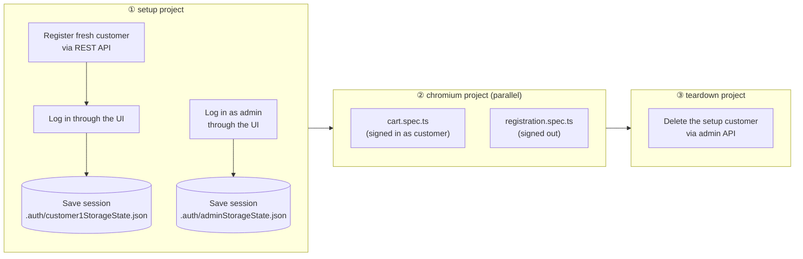
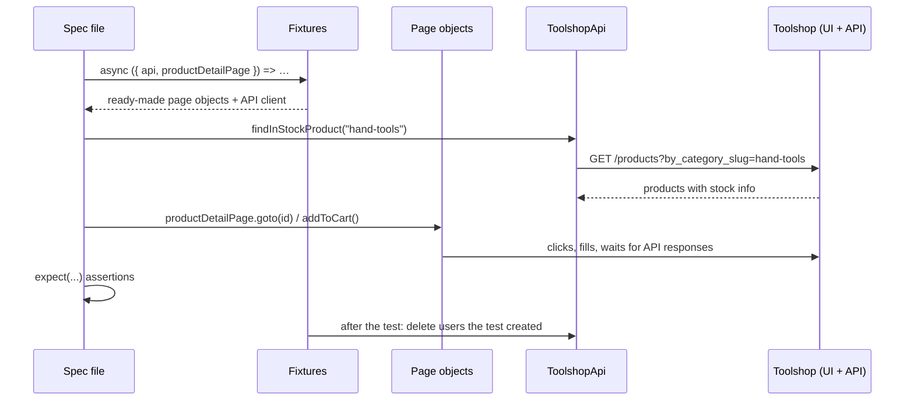

# Toolshop E2E Test Framework

[](https://github.com/hathihuyen/ecom-test-project-playwright/actions/workflows/playwright.yml)


End-to-end test automation for the [Practice Software Testing – Toolshop](https://practicesoftwaretesting.com), a demo e-commerce web shop, built with **Playwright** and **TypeScript**.

The framework tests the **UI** like a real customer would. It uses the shop's **REST API** to prepare and clean up test data quickly and reliably. Each test run creates its own user accounts and data and deletes them afterwards. Shared demo accounts, product stock or leftover state from earlier runs can't make it fail.

The same suite runs against two targets with no code changes:

- the **public live site**, the default for quick local runs, or
- a **private copy of the Toolshop in Docker**, used by CI and available locally. It has no bot protection, no scheduled data resets and no other users.

---

## Table of contents

1. [Highlights](#highlights)
2. [Tech stack](#tech-stack)
3. [Quick start](#quick-start)
4. [Test environments: live site vs Docker](#test-environments-live-site-vs-docker)
5. [Running tests](#running-tests)
6. [How it works](#how-it-works)
7. [Project structure](#project-structure)
8. [Architecture & design decisions](#architecture--design-decisions)
9. [Test coverage](#test-coverage)
10. [Data-driven tests](#data-driven-tests)
11. [Writing a new test](#writing-a-new-test)
12. [Conventions](#conventions)
13. [Reports & debugging](#reports--debugging)
14. [Continuous integration](#continuous-integration)
15. [Configuration reference](#configuration-reference)
16. [Troubleshooting](#troubleshooting)
17. [Roadmap](#roadmap)

---

## Highlights

|                                    |                                                                                                                                  |
| ---------------------------------- | -------------------------------------------------------------------------------------------------------------------------------- |
| **Page Object Model + components** | Pages hold locators and user actions. Shared UI such as the nav bar is a reusable component.                                     |
| **Enum-based locators**            | Every `data-test` id lives in an `enum` at the top of its page file. Constructors never contain string literals.                 |
| **Data-driven tests**              | Test cases are typed data arrays (`data/*.data.ts`). Adding a case means adding one object, with no new test code.               |
| **Custom fixtures**                | Tests ask for `registrationPage`, `api` and so on, and get ready-to-use objects. Nothing needs `new` inside a test.              |
| **API-first test data**            | Users are created through the REST API in about a second. The UI is used only for the behaviour under test.                      |
| **Self-cleaning**                  | Every user a test creates is deleted afterwards, by a fixture or by a teardown project. Cleanup never fails a run.               |
| **Login once, reuse everywhere**   | A `setup` project logs in once and saves the session. All tests start already signed in.                                         |
| **Isolated runs**                  | Each run uses a fresh customer account, so lockouts and database resets on the shared demo site can't break it.                  |
| **Self-contained CI**              | CI starts its own Toolshop in Docker (pinned to app version 2.5), seeds it, and tests that copy rather than the public internet. |
| **Resilient to live data**         | Products are chosen at runtime by asking the API what is in stock. No hard-coded ids or names.                                   |
| **Typed end to end**               | Strict TypeScript, a shared `User` model, typed page objects and typed environment config.                                       |
| **Tag-based suites**               | `@smoke`, `@regression`, `@negative`, `@edge` and `@stress` let you run exactly the subset you need.                             |
| **Quality gates**                  | Type check, ESLint (including Playwright rules and missing-`await` detection) and Prettier run in CI before any test.            |
| **Rich failure evidence**          | Each failed test keeps a trace, a video and a screenshot. CI also saves JUnit results, GitHub annotations and container logs.    |

---

## Tech stack

| Tool                                                                                                                                                                            | Purpose                                                |
| ------------------------------------------------------------------------------------------------------------------------------------------------------------------------------- | ------------------------------------------------------ |
| [Playwright Test](https://playwright.dev)                                                                                                                                       | Test runner, browser automation, API requests, tracing |
| [TypeScript](https://www.typescriptlang.org)                                                                                                                                    | Static typing (strict mode), path aliases              |
| [Faker.js](https://fakerjs.dev)                                                                                                                                                 | Realistic random test data                             |
| [dotenv](https://github.com/motdotla/dotenv)                                                                                                                                    | Loads `.env` files per environment                     |
| [ESLint](https://eslint.org) + [typescript-eslint](https://typescript-eslint.io) + [eslint-plugin-playwright](https://github.com/playwright-community/eslint-plugin-playwright) | Static analysis and Playwright best practices          |
| [Prettier](https://prettier.io)                                                                                                                                                 | Consistent code formatting                             |
| [Docker Compose](https://docs.docker.com/compose/)                                                                                                                              | Private Toolshop instance for CI and local runs        |
| [GitHub Actions](https://docs.github.com/actions)                                                                                                                               | CI pipeline                                            |

---

## Quick start

### Prerequisites

- **Node.js 22+**. The version is pinned in [`.nvmrc`](.nvmrc); with nvm, run `nvm use`.
- **Git**
- Admin credentials for the Toolshop. They're published in the [Toolshop documentation](https://testsmith-io.github.io/practice-software-testing/#/).
- _Optional:_ **Docker** with the Compose and buildx plugins, to run the private Toolshop copy (see [Test environments](#test-environments-live-site-vs-docker)).

### 1. Install

```bash
git clone https://github.com/hathihuyen/ecom-test-project-playwright.git
cd ecom-test-project-playwright
npm ci                                  # exact versions from package-lock.json
npx playwright install --with-deps chromium
```

### 2. Configure

```bash
cp .env.example .env
```

Then fill in `.env`:

```dotenv
BASE_URL=https://practicesoftwaretesting.com
API_URL=https://api.practicesoftwaretesting.com
ADMIN_EMAIL=<admin email>
ADMIN_PASSWORD=<admin password>
```

> `.env` is git-ignored and must never be committed. You don't need customer credentials, because the framework creates its own customer on every run.

### 3. Run

```bash
npm test               # full suite against the live site
npm run report         # open the HTML report
```

To run against the private Docker copy instead, see the next section.

---

## Test environments: live site vs Docker

|                                     | Live site (default locally)                  | Docker copy (CI, optional locally)                        |
| ----------------------------------- | -------------------------------------------- | --------------------------------------------------------- |
| URLs                                | `practicesoftwaretesting.com` / `api.…`      | `http://localhost:4200` / `http://localhost:8091`         |
| Cloudflare bot check                | Yes. **Blocks CI runners** (data-centre IPs) | None                                                      |
| Data resets                         | On the hour, several times a day             | Never during a run (the reset `cron` service is left out) |
| Other users changing stock/accounts | Yes                                          | No. Fresh seed data each time                             |
| Occasional slow or stalled pages    | Yes                                          | No                                                        |
| Setup needed                        | `.env` only                                  | Docker + `.env.docker`                                    |

**Use the Docker copy** for anything that must be reliable (CI, before a merge, debugging a flaky test). Use the live site for a quick check, for example `npm run test:smoke`.

### Running against the Docker copy locally

**One-time setup (Ubuntu):**

```bash
sudo apt install -y docker.io docker-compose-v2 docker-buildx
sudo usermod -aG docker $USER      # then log out of the desktop session and back in
```

Create `.env.docker` (git-ignored by the `.env.*` rule). These are the default accounts the Docker copy creates:

```dotenv
BASE_URL=http://localhost:4200
API_URL=http://localhost:8091
ADMIN_EMAIL=admin@practicesoftwaretesting.com
ADMIN_PASSWORD=welcome01
```

**Every session:**

```bash
npm run toolshop:up            # start the containers (first time: a few minutes to download ~1.5 GB)
sleep 30                       # give MariaDB time to start
npm run toolshop:seed          # create tables + demo data
TEST_ENV=docker npm test       # TEST_ENV=docker loads .env.docker
npm run toolshop:down          # stop and remove everything, including data
```

### What's in `docker/`

| File                                                         | Purpose                                                                                                                                                          |
| ------------------------------------------------------------ | ---------------------------------------------------------------------------------------------------------------------------------------------------------------- |
| [`docker/toolshop-compose.yml`](docker/toolshop-compose.yml) | Based on the Toolshop's own `docker-compose.prod.yml`, with app images pinned to **2.5** and the data-resetting `cron` service removed                           |
| [`docker/web/Dockerfile`](docker/web/Dockerfile)             | Builds the nginx gateway locally. The published `practice-software-testing-web` image only exists for **arm64**, so it can't run on x86_64 PCs or GitHub runners |
| [`docker/web/vhost.conf`](docker/web/vhost.conf)             | nginx config from the Toolshop repo: forwards API requests on port 8091 to the Laravel API                                                                       |

| Container     | Image                                                 | Port               |
| ------------- | ----------------------------------------------------- | ------------------ |
| `angular-ui`  | `testsmith/practice-software-testing-sprint5-ui:2.5`  | `4200` (web shop)  |
| `web`         | built from `docker/web/` (nginx)                      | `8091` (REST API)  |
| `laravel-api` | `testsmith/practice-software-testing-sprint5-api:2.5` | internal (PHP-FPM) |
| `mariadb`     | `yobasystems/alpine-mariadb:10.6.11`                  | `3306`             |

---

## Running tests

### npm scripts

| Command                           | What it does                                                    |
| --------------------------------- | --------------------------------------------------------------- |
| `npm test`                        | Run the full suite (setup → tests → teardown)                   |
| `npm run test:smoke`              | Only tests tagged `@smoke`, a fast confidence check             |
| `npm run test:regression`         | Only tests tagged `@regression`                                 |
| `npm run test:stress`             | The opt-in concurrency test (`@stress`), in its own project     |
| `npm run test:login`              | Only the login suite (`tests/e2e/login.spec.ts`)                |
| `npm run test:headed`             | Run with a visible browser window                               |
| `npm run test:ui`                 | Playwright **UI mode**: watch, time-travel, re-run single tests |
| `npm run test:debug`              | Step through a test with the Playwright Inspector               |
| `npm run report`                  | Open the last HTML report                                       |
| `npm run typecheck`               | TypeScript type check (`tsc --noEmit`)                          |
| `npm run lint` / `lint:fix`       | ESLint, optionally auto-fixing                                  |
| `npm run format` / `format:check` | Prettier write / verify                                         |
| `npm run toolshop:up`             | Start the private Toolshop in Docker (builds `web` if needed)   |
| `npm run toolshop:seed`           | Create the Docker Toolshop's database tables and demo data      |
| `npm run toolshop:down`           | Stop the Docker Toolshop and delete its data                    |

### Useful Playwright CLI options

```bash
npx playwright test tests/e2e/cart.spec.ts            # one file
npx playwright test -g "validation errors"            # tests whose title matches
npx playwright test --grep @negative                  # only negative tests (also: @edge, @smoke, …)
npx playwright test --repeat-each=5                   # hunt for flaky tests
npx playwright test --project=setup                   # only the login setup
npx playwright test --list                            # list tests without running them
TEST_ENV=docker npx playwright test                   # use .env.docker (the Docker Toolshop)
ALL_BROWSERS=1 npx playwright test                    # add Firefox and WebKit projects
```

---

## How it works

### Test run lifecycle

Playwright **projects** are chained with dependencies, so every run follows the same lifecycle:



1. **`setup`** ([`tests/setup/auth.setup.ts`](tests/setup/auth.setup.ts)) runs first, once per run.
    - It **registers a brand-new customer through the API**, logs in through the real login form and saves the browser session (the auth token in `localStorage`) to `.auth/customer1StorageState.json`.
    - It logs in as the **admin** and saves that session too.
    - Logins use `LoginPage.loginAs()`. If the site rejects a login, the error contains the site's own message (for example _"Account locked…"_), not a generic timeout.
2. **`chromium`** runs the specs in parallel. Each test starts **already signed in as the customer**, because the project's `storageState` points at the saved session. Specs that need a signed-out browser (registration) override this with an empty storage state.
3. **`teardown`** ([`tests/setup/global.teardown.ts`](tests/setup/global.teardown.ts)) runs after all tests have finished and deletes the setup customer through the admin API. It is **best-effort**: if the delete fails (for example because the live site's database is being reset), it logs a warning instead of failing a run whose tests passed.

### Inside a single test



- **Arrange** through the API: fast, and it doesn't depend on other screens working.
- **Act** through page objects: the same actions a real user takes.
- **Assert** with Playwright's web-first `expect`, which retries automatically until the condition is true or the timeout is reached.
- **Clean up** automatically in fixture teardown, even when the test fails. Cleanup errors are logged as warnings, never as test failures.

---

## Project structure

```
.
├── .github/workflows/
│   └── playwright.yml          # CI: quality gate → Docker Toolshop → E2E tests → reports
├── api/
│   └── toolshop.api.ts         # Typed REST client: register, login, find product, delete user
├── components/
│   └── header.component.ts     # Nav bar shared by every page (user menu, categories, cart badge)
├── config/
│   ├── auth.ts                 # Paths of saved sessions, admin display name
│   ├── env.ts                  # Loads .env / .env.<TEST_ENV>, validates required variables
│   ├── routes.ts               # App URLs (ROUTES) and API endpoints (enum ApiPath) in one place
│   └── timeouts.ts             # All timeouts as named constants
├── data/
│   ├── factory.ts              # Faker-based builders: createUser(), createUsers(), createInvalidUser()…
│   ├── login.data.ts           # Data-driven login cases: invalid input, rejected credentials, accepted variants
│   ├── messages.ts             # enum LoginMessage: every text the app shows, exactly as rendered
│   └── products.ts             # Static product references (only for stock-independent checks)
├── docker/
│   ├── toolshop-compose.yml    # Private Toolshop: UI, API, nginx gateway, MariaDB (app pinned to 2.5)
│   └── web/                    # nginx gateway built locally (upstream image is arm64-only)
│       ├── Dockerfile
│       └── vhost.conf
├── fixtures/
│   └── index.ts                # Custom `test`: page objects, API client, cleanup, registeredUser
├── pages/
│   ├── base.page.ts            # Abstract base: holds `page` + `header`
│   ├── login.page.ts           # enum LoginLocator / LoginField / SubmitMethod + login actions
│   ├── registration.page.ts
│   ├── product-list.page.ts
│   └── product-detail.page.ts
├── tests/
│   ├── setup/
│   │   ├── auth.setup.ts       # Creates customer + saves sessions (runs first)
│   │   └── global.teardown.ts  # Deletes the setup customer, best-effort (runs last)
│   └── e2e/
│       ├── cart.spec.ts
│       ├── login.spec.ts       # Data-driven negative + edge cases, account lockout
│       ├── registration.spec.ts
│       └── concurrent-registration.spec.ts
├── types/
│   └── user.ts                 # Shared `User` model
├── .env.example                # Template of required environment variables
├── eslint.config.mjs           # ESLint flat config (TypeScript + Playwright rules)
├── .prettierrc.json            # Formatting rules (+ .prettierignore)
├── playwright.config.ts        # Projects, reporters, retries, timeouts, artefacts
└── tsconfig.json               # Strict TS + path aliases
```

### Path aliases

Imports between folders use aliases defined in [`tsconfig.json`](tsconfig.json), so they never depend on how deep a file is:

```ts
import { test, expect } from "@fixtures";
import { createUser } from "@data/factory";
import { ROUTES } from "@config/routes";
```

| Alias           | Folder              |
| --------------- | ------------------- |
| `@fixtures`     | `fixtures/index.ts` |
| `@pages/*`      | `pages/*`           |
| `@components/*` | `components/*`      |
| `@api/*`        | `api/*`             |
| `@config/*`     | `config/*`          |
| `@data/*`       | `data/*`            |
| `@models/*`     | `types/*`           |

Imports inside the same folder stay relative, for example `./base.page`.

---

## Architecture & design decisions

The framework is built in layers. Each layer may only use the layers below it:

```
 Specs (tests/e2e)          what to test       — readable scenarios, tags, assertions
    │
 Fixtures (fixtures/)       wiring             — builds page objects / API client, cleans up
    │
 Page objects + components  how to do it (UI)  — locators and user actions
 API client                 how to do it (API) — data setup and cleanup
    │
 Config / data / types      shared foundations — env, routes, timeouts, factories, models
```

### Key decisions and why

| Decision                                                                                       | Why                                                                                                                                                                                                                                                                                                                              |
| ---------------------------------------------------------------------------------------------- | -------------------------------------------------------------------------------------------------------------------------------------------------------------------------------------------------------------------------------------------------------------------------------------------------------------------------------- |
| **Composition for the header** (`page.header.cartQuantity`) instead of inheriting nav locators | Every page _has_ a nav bar, but it isn't one. Shared UI lives in one component that any page can use.                                                                                                                                                                                                                            |
| **`page` is `protected` in page objects**                                                      | Tests can't bypass the page object with raw locators. A test that needs `page` (for example for `toHaveURL`) gets it from the fixture.                                                                                                                                                                                           |
| **Page objects return results, specs assert**                                                  | `registrationPage.register(user)` returns `{ status, userId }` and the spec decides what to expect. Page objects only wait for their own action to complete, for example `addToCart()` waits for the cart API call.                                                                                                              |
| **Fresh customer per run, created via API**                                                    | The public demo accounts get locked by other people's failed logins, and accounts you create by hand disappear when the demo database resets. A new account each run avoids both and starts with an empty cart.                                                                                                                  |
| **Products chosen at runtime** (`api.findInStockProduct`)                                      | Stock on the public shop changes all day and product ids change on every reset. Hard-coding either one makes tests flaky.                                                                                                                                                                                                        |
| **`route.fetch()` to capture the register response**                                           | The app redirects right after registering, and Chromium throws away the response body of the page it navigates away from. Intercepting the request with `page.route()` and making it through Playwright with `route.fetch()` keeps the body available. The page still receives the identical response through `route.fulfill()`. |
| **Cleanup in fixtures, not in `afterEach`**                                                    | `cleanupUsers` runs after every test that uses it, even a failed one, and only logs in as admin when there is something to delete.                                                                                                                                                                                               |
| **Best-effort cleanup**                                                                        | Deleting test data is housekeeping. If it fails (for example during a database reset, which removes the data anyway), a warning is logged and the test result stays what the test itself decided.                                                                                                                                |
| **CI tests a private Docker Toolshop, not the public site**                                    | The public site is behind a Cloudflare bot check that blocks GitHub's runners, resets its database on the hour and sometimes stalls. A pinned, freshly seeded copy makes CI results depend only on the app and the tests.                                                                                                        |
| **Same suite, different target via `TEST_ENV`**                                                | Nothing in the tests knows which server it talks to. `BASE_URL`/`API_URL` come from `.env.<TEST_ENV>`, so switching targets needs no code change.                                                                                                                                                                                |
| **Environment getters that fail fast**                                                         | `env.adminEmail` throws _"Missing environment variable ADMIN_EMAIL…"_ the moment it is needed, instead of an `undefined` reaching a form field.                                                                                                                                                                                  |
| **No hard waits**                                                                              | There's no `waitForTimeout` anywhere. Waits are tied to real events (API responses, element states) through web-first assertions.                                                                                                                                                                                                |
| **`data-test` attributes as locators**                                                         | `testIdAttribute: "data-test"` matches the app's dedicated test hooks. These are stable across styling and copy changes.                                                                                                                                                                                                         |
| **Locator ids in an `enum` at the top of each page file**                                      | When the app renames a `data-test` id there is exactly one line to change, the compiler catches typos, and editors autocomplete the ids. Plain `enum` is used, not `const enum`: Playwright compiles each file separately, and `const enum` values imported from another file don't survive that.                                |
| **App texts in `enum LoginMessage`**                                                           | Expected messages are written once, exactly as the app renders them, and shared by data and specs. A copy change in the app is a one-line fix.                                                                                                                                                                                   |
| **Data-driven: one array and one loop per kind of outcome**                                    | Invalid input, rejected credentials and accepted variants each have their own typed array and their own assertions. A single array with a `switch` on the outcome would hide conditions inside tests, which ESLint's `playwright/no-conditional-in-test` rule warns about.                                                       |
| **A fresh account per test (`registeredUser`)**                                                | Cases that need a real account get their own, built from it with small functions such as `(u) => u.email.toUpperCase()`. The lockout test can't lock an account another test uses, so everything stays safe in parallel.                                                                                                         |
| **Stateful scenarios stay ordinary tests**                                                     | The lockout test depends on the order of its attempts, so it's written as one test with `test.step`s rather than squeezed into a data table.                                                                                                                                                                                     |
| **Proving "no API call" by counting requests**                                                 | For client-side validation, `loginPage.trackLoginRequests()` counts `POST /users/login` calls. The test asserts the count is 0 once the field errors are visible. No fixed wait for a request that should never happen.                                                                                                          |

---

## Test coverage

| Spec                                                                           | Test                                                                        | Tags                      | Session    |
| ------------------------------------------------------------------------------ | --------------------------------------------------------------------------- | ------------------------- | ---------- |
| [`cart.spec.ts`](tests/e2e/cart.spec.ts)                                       | Customer can add an in-stock product to the cart and the cart badge shows 1 | `@smoke` `@regression`    | Customer   |
| [`registration.spec.ts`](tests/e2e/registration.spec.ts)                       | New user can register and is sent to the login page (API returns 201)       | `@smoke` `@regression`    | Signed out |
| [`registration.spec.ts`](tests/e2e/registration.spec.ts)                       | Invalid data shows field-level validation errors                            | `@regression`             | Signed out |
| [`concurrent-registration.spec.ts`](tests/e2e/concurrent-registration.spec.ts) | Several users register at the same time in separate browser contexts        | `@stress`                 | Signed out |
| [`login.spec.ts`](tests/e2e/login.spec.ts)                                     | 8 form-validation cases: field error shown, no API call                     | `@regression` `@negative` | Signed out |
| [`login.spec.ts`](tests/e2e/login.spec.ts)                                     | 4 rejected-credential cases: HTTP 401 and a generic error message           | `@regression` `@negative` | Signed out |
| [`login.spec.ts`](tests/e2e/login.spec.ts)                                     | 3 accepted edge cases: upper-case email, spaces around email, Enter key     | `@regression` `@edge`     | Signed out |
| [`login.spec.ts`](tests/e2e/login.spec.ts)                                     | Account is locked after 3 wrong passwords; even the correct one gets 423    | `@regression` `@negative` | Signed out |

`@stress` tests are excluded from the default run and only run with `npm run test:stress`.

### Login cases in detail

The expected behaviour was checked against the real application, not assumed.

| Group                | Input                                                                                        | Expected                                                                                |
| -------------------- | -------------------------------------------------------------------------------------------- | --------------------------------------------------------------------------------------- |
| Form validation      | Empty email and password                                                                     | `Email is required` + `Password is required`, no API call                               |
| Form validation      | Empty email / empty password                                                                 | `Email is required` / `Password is required`                                            |
| Form validation      | `not-an-email`, SQL injection `' OR '1'='1`, 262-character email                             | `Email format is invalid`                                                               |
| Form validation      | Password of 1 or 2 characters (minimum is 3)                                                 | `Password length is invalid`                                                            |
| Rejected credentials | Unknown email, wrong password, password in the wrong letter case, wrong 3-character password | HTTP 401, `Invalid email or password` (the same text whether the email exists or not)   |
| Accepted variants    | Email in UPPER CASE, email with spaces around it, submit with Enter                          | HTTP 200, redirected to `/account`, user's name in the nav bar                          |
| Lockout              | 3 wrong passwords, then the correct one                                                      | HTTP 423, `Account locked, too many failed attempts. Please contact the administrator.` |

---

## Data-driven tests

Cases live in **`data/<feature>.data.ts`** as typed arrays. The spec loops over each array and generates one test per entry, named from the case's `title`:

```ts
// data/login.data.ts – one object per case
export const REJECTED_CREDENTIAL_CASES: CredentialCase[] = [
    { title: "unknown email", email: (u) => `unknown.${u.email}`, password: (u) => u.password },
    { title: "wrong password", email: (u) => u.email, password: () => "Wrong#Pass1" },
    // …
];

// tests/e2e/login.spec.ts – one loop generates the tests
for (const data of REJECTED_CREDENTIAL_CASES) {
    test(`rejects ${data.title}`, async ({ loginPage, registeredUser }) => {
        await loginPage.goto();
        const status = await loginPage.loginAndGetStatus(data.email(registeredUser), data.password(registeredUser));
        expect(status).toBe(401);
        await expect(loginPage.errorMessage).toHaveText(LoginMessage.InvalidCredentials);
    });
}
```

**Two kinds of case data:**

| Type               | Values                                       | Used when                                                                                 |
| ------------------ | -------------------------------------------- | ----------------------------------------------------------------------------------------- |
| `InvalidInputCase` | Plain strings                                | The input never reaches the server (form validation)                                      |
| `CredentialCase`   | Functions of a `User`, e.g. `(u) => u.email` | The case needs a real account; the `registeredUser` fixture provides a fresh one per test |

### Adding a login case

1. If the app shows a new text, add it to `LoginMessage` in [`data/messages.ts`](data/messages.ts).
2. Add one object to the matching array in [`data/login.data.ts`](data/login.data.ts).
3. Run `npm run test:login`. The new test appears automatically, named after its `title`.

Only add cases whose behaviour you have confirmed in the app, for example with `npm run test:ui` or the browser's DevTools.

---

## Writing a new test

Example: **"a customer can open the contact page"**.

### 1. Add the route — [`config/routes.ts`](config/routes.ts)

```ts
export const ROUTES = {
    // …
    contact: "/contact",
} as const;
```

### 2. Create a page object — `pages/contact.page.ts`

Locator ids go in an `enum` at the top of the file. The constructor only uses enum members.

```ts
import { Locator, Page } from "@playwright/test";
import { BasePage } from "./base.page";
import { ROUTES } from "@config/routes";

/** `data-test` ids of the contact page. Look up the real ids in DevTools or with `npx playwright codegen`. */
export enum ContactLocator {
    FirstNameInput = "first-name",
    SendButton = "contact-submit",
}

export class ContactPage extends BasePage {
    readonly firstNameInput: Locator;
    readonly sendButton: Locator;

    constructor(page: Page) {
        super(page);
        this.firstNameInput = page.getByTestId(ContactLocator.FirstNameInput);
        this.sendButton = page.getByTestId(ContactLocator.SendButton);
    }

    async goto() {
        await this.page.goto(ROUTES.contact);
    }
}
```

### 3. Register it as a fixture — [`fixtures/index.ts`](fixtures/index.ts)

```ts
type Fixtures = {
    // …
    contactPage: ContactPage;
};

export const test = base.extend<Fixtures>({
    // …
    contactPage: async ({ page }, use) => {
        await use(new ContactPage(page));
    },
});
```

### 4. Write the spec — `tests/e2e/contact.spec.ts`

```ts
import { test, expect } from "@fixtures";

test.describe("Contact", () => {
    test("customer can open the contact form", { tag: "@regression" }, async ({ contactPage }) => {
        await contactPage.goto();
        await expect(contactPage.firstNameInput).toBeVisible();
    });
});
```

### 5. Verify

```bash
npm run typecheck && npm run lint
TEST_ENV=docker npx playwright test tests/e2e/contact.spec.ts --repeat-each=3
```

### Which session does my test get?

| Need                                   | How                                                                           |
| -------------------------------------- | ----------------------------------------------------------------------------- |
| Signed in as **customer** (default)    | Nothing to do                                                                 |
| **Signed out**                         | `test.use({ storageState: { cookies: [], origins: [] } });`                   |
| Signed in as **admin**                 | `test.use({ storageState: AUTH_FILES.admin });` (import from `@config/auth`)  |
| A **brand-new account** to log in with | Ask for the `registeredUser` fixture (registered via API, deleted afterwards) |

### Available fixtures

| Fixture                                                                 | Gives you                                                                                                    |
| ----------------------------------------------------------------------- | ------------------------------------------------------------------------------------------------------------ |
| `loginPage`, `registrationPage`, `productListPage`, `productDetailPage` | Ready-made page objects on the test's `page`                                                                 |
| `api`                                                                   | `ToolshopApi` REST client                                                                                    |
| `cleanupUsers`                                                          | An array: push ids of users you create and they're deleted after the test (best-effort)                      |
| `registeredUser`                                                        | A fresh customer (`User`, including `email` and `password`), registered via API and cleaned up automatically |

---

## Conventions

- **Locators:** prefer `getByTestId` (the `data-test` attribute), then `getByRole` / `getByLabel`. Avoid CSS and XPath.
- **Locator ids live in an `enum` at the top of each page file** (for example `LoginLocator`). Constructors use only enum members, never string literals. Use `enum`, not `const enum`.
- **No hard-coded strings for app texts or endpoints:** expected messages come from `data/messages.ts`, API paths from `ApiPath` in `config/routes.ts`.
- **Data-driven tests:** cases live in `data/<feature>.data.ts` as typed arrays, with one array and one loop per kind of outcome. Stateful scenarios (like lockout) stay ordinary tests with `test.step`s.
- **No raw locators in specs.** If a spec needs an element, add it to the page object.
- **No hard waits** (`waitForTimeout`). Wait for a response, a URL or an element state.
- **No hard-coded live data.** Product ids and stock come from the API at runtime, and users come from the factory.
- **Every test cleans up** what it creates. Push created user ids into `cleanupUsers`.
- **Every test has a tag.** Use `@smoke` for critical paths, `@regression` for full coverage, `@negative` for invalid input and rejections, `@edge` for unusual-but-valid input, and `@stress` for opt-in load-style tests.
- **Test titles describe behaviour:** _"customer can add a product to the cart"_, not _"test cart 1"_.
- **Magic numbers go in `config/`:** timeouts in `timeouts.ts`, URLs in `routes.ts`.
- **Commit only green code:** `npm run typecheck && npm run lint && npm run format:check && npm test`. Run `npm run format` after editing any file, including YAML and Markdown, because CI checks formatting too.

---

## Reports & debugging

### Artefacts on failure

| Artefact                                           | When         | Where                                            |
| -------------------------------------------------- | ------------ | ------------------------------------------------ |
| HTML report                                        | Every run    | `playwright-report/`, open with `npm run report` |
| Trace (DOM snapshots, network, console, timeline)  | Failed tests | `test-results/<test>/trace.zip`                  |
| Video                                              | Failed tests | `test-results/<test>/video.webm`                 |
| Screenshot                                         | Failed tests | `test-results/<test>/test-failed-1.png`          |
| AI-friendly error context (page snapshot + source) | Failed tests | `test-results/<test>/error-context.md`           |
| JUnit XML                                          | CI only      | `test-results/junit.xml`                         |
| Docker Toolshop container logs                     | CI failures  | `test-results/toolshop-containers.log`           |

### Retries and "flaky" results

Failed tests are retried **once locally** and **twice in CI**. A test that fails first and then passes on retry is reported as **flaky**, not passed, in both the terminal summary and the HTML report. One-off hiccups of the public site therefore don't fail the run, but they stay visible. A real bug fails every attempt.

### Debugging workflow

1. `npm run report`, click the failed test and open the **Trace** tab.
2. In the trace viewer, check the **Network** tab first: an unexpected `4xx` or `5xx` usually explains the failure. For example, `401` means bad credentials, `422` means invalid request data and `423` means a locked account. A request with no response at all (`-1`) means the server stalled.
3. Check the failure's time. On the live site, many `500`s or unexpected `401`s at `hh:00` mean a database reset, not a bug.
4. Re-run just that test in UI mode: `npm run test:ui`.
5. Step through it: `npx playwright test <file> -g "<title>" --debug`.
6. If it only fails on the live site, re-run it against the Docker copy (`TEST_ENV=docker`) to separate site problems from real bugs.

The HTML report never opens automatically (`open: "never"`), so a run always exits on its own. Open the report with `npm run report` and stop it with `Ctrl+C`.

---

## Continuous integration

The pipeline is defined in [`.github/workflows/playwright.yml`](.github/workflows/playwright.yml).


**Why CI uses Docker:** the public site is protected by a Cloudflare bot check. Requests from GitHub's runners get a _"Performing security verification"_ page instead of the shop, so no UI test could ever pass there. CI therefore starts its own Toolshop from [`docker/toolshop-compose.yml`](docker/toolshop-compose.yml) and tests `http://localhost:4200` / `http://localhost:8091`.

### Jobs

1. **Type check, lint & format**: `npm ci`, `typecheck`, `lint`, `format:check`. Fails in under a minute, before anything heavy is installed.
2. **E2E tests** (only after step 1 passes):
    1. Start the Toolshop containers (in the background while Node and browsers install)
    2. `npm ci` and install the Playwright browsers (Chromium; all three on the nightly run)
    3. Wait for MariaDB, then create and seed the database (`php artisan migrate:fresh --seed`)
    4. Wait until the API (`/status`) and the UI answer
    5. Run the suite with `BASE_URL` / `API_URL` pointing at the containers
    6. Upload the HTML report; on failure also upload traces, videos and the container logs

| Trigger                       | Browsers                  | Notes                                       |
| ----------------------------- | ------------------------- | ------------------------------------------- |
| Push / pull request to `main` | Chromium                  | Required check                              |
| Nightly schedule (weekdays)   | Chromium, Firefox, WebKit | 05:30 UTC, sets `ALL_BROWSERS=1`            |
| Manual (`workflow_dispatch`)  | Chromium                  | _Actions → Playwright Tests → Run workflow_ |

**CI behaviour** (from [`playwright.config.ts`](playwright.config.ts) when `CI` is set):

- `retries: 2`
- `workers: 2`, because the browsers and the Docker Toolshop share one runner
- `forbidOnly: true`, so a forgotten `test.only` fails the build
- Reporters: `github` (inline annotations on the PR), `html` and `junit`
- A newer push to the same branch cancels the run still in progress (`concurrency`)
- Actions run on their current major versions (`checkout`, `setup-node`, `upload-artifact` **v7**, Node 24)

### Required repository settings

_Settings → Secrets and variables → Actions_

| Name             | Type   | Value                                                                       |
| ---------------- | ------ | --------------------------------------------------------------------------- |
| `ADMIN_EMAIL`    | Secret | Admin account email (the Docker copy seeds the same admin as the live site) |
| `ADMIN_PASSWORD` | Secret | Admin account password                                                      |

`BASE_URL` and `API_URL` are set inside the workflow to the Docker containers, so no repository variables are needed.

After a run, download **playwright-report** (and **test-results** when something failed) from the bottom of the run summary page.

---

## Configuration reference

### Environment variables

| Variable         | Required | Default                                   | Purpose                                                                              |
| ---------------- | -------- | ----------------------------------------- | ------------------------------------------------------------------------------------ |
| `BASE_URL`       | No       | `https://practicesoftwaretesting.com`     | Web app under test                                                                   |
| `API_URL`        | No       | `https://api.practicesoftwaretesting.com` | REST API used for setup and cleanup                                                  |
| `ADMIN_EMAIL`    | **Yes**  | —                                         | Admin login (setup + user cleanup)                                                   |
| `ADMIN_PASSWORD` | **Yes**  | —                                         | Admin login                                                                          |
| `TEST_ENV`       | No       | —                                         | Loads `.env.<TEST_ENV>` before `.env`, for example `TEST_ENV=docker` → `.env.docker` |
| `STRESS`         | No       | —                                         | Adds the `stress` project                                                            |
| `ALL_BROWSERS`   | No       | —                                         | Adds the `firefox` and `webkit` projects                                             |
| `CI`             | No       | —                                         | Set automatically by GitHub Actions; switches to CI behaviour                        |

Precedence is: **real environment variables > `.env.<TEST_ENV>` > `.env` > defaults.**

### Timeouts — [`config/timeouts.ts`](config/timeouts.ts)

| Name         | Value | Applies to                                           |
| ------------ | ----- | ---------------------------------------------------- |
| `test`       | 30 s  | Whole test                                           |
| `expect`     | 5 s   | Each web-first assertion                             |
| `action`     | 10 s  | Each click, fill and so on                           |
| `navigation` | 15 s  | `page.goto` and navigations                          |
| `toast`      | 10 s  | Waiting for the "added to cart" message to disappear |

### Retries and workers

|         | Local                          | CI  |
| ------- | ------------------------------ | --- |
| Retries | 1                              | 2   |
| Workers | Playwright default (CPU-based) | 2   |

### Playwright projects

| Project                                | Runs                        | Depends on                      | Default session |
| -------------------------------------- | --------------------------- | ------------------------------- | --------------- |
| `setup`                                | `*.setup.ts`                | —                               | none            |
| `teardown`                             | `*.teardown.ts`             | runs after `setup`'s dependants | none            |
| `chromium`                             | everything except `@stress` | `setup`                         | customer        |
| `stress` _(STRESS=1)_                  | only `@stress`              | —                               | none            |
| `firefox`, `webkit` _(ALL_BROWSERS=1)_ | everything except `@stress` | `setup`                         | customer        |

---

## Troubleshooting

### Tests

| Symptom                                                                                               | Cause                                                                                | Fix                                                                                                                                    |
| ----------------------------------------------------------------------------------------------------- | ------------------------------------------------------------------------------------ | -------------------------------------------------------------------------------------------------------------------------------------- |
| `Login failed for …: Account locked, too many failed attempts`                                        | Shared demo account locked by other users                                            | Only affects fixed accounts. The setup customer is fresh every run. For admin, wait for the demo site's next reset.                    |
| `Login failed for …: Invalid email or password`                                                       | Wrong `.env` values, or the account was removed by a demo reset                      | Check `.env`. Accounts created by visitors don't survive resets.                                                                       |
| `Missing environment variable "ADMIN_EMAIL"`                                                          | `.env` not created, or a CI secret is missing                                        | `cp .env.example .env` and fill it in, or add the repository secret                                                                    |
| `Register failed: {"email":["The email field is required."]}` (HTTP 422)                              | Request body is missing a field                                                      | Always register through `api.registerUser(user)`, which builds the typed body                                                          |
| Add-to-cart button disabled / click timeout                                                           | Product is out of stock on the live site                                             | Pick products with `api.findInStockProduct()`, never by fixed name or id                                                               |
| `response.json: No resource with given identifier found`                                              | Reading a response body after the page navigated away                                | Capture it with `page.route` + `route.fetch()`, as in `RegistrationPage.register()`                                                    |
| Many `500`s or unexpected `401`s around `hh:00` (live site)                                           | The demo site rebuilds its database on the hour                                      | Re-run a few minutes later, or use the Docker copy                                                                                     |
| Test timeout; a page request in the trace never got a response (`-1`)                                 | The live site occasionally stalls page loads                                         | The local retry usually absorbs it (reported as flaky). For reliable results use `TEST_ENV=docker`.                                    |
| `project 'setup' has unknown teardown project 'teardown'`                                             | `teardown` project missing from config                                               | Keep the `teardown` project defined in `playwright.config.ts`                                                                          |
| Both setup tests time out (`page.goto` / `apiRequestContext.post`) and every other test "did not run" | The target site was down or unreachable; all tests depend on `setup`                 | Check the site (`curl …/status`), wait and re-run, or use the Docker copy. With `TEST_ENV=docker`, make sure `npm run toolshop:up` ran |
| `Error: No tests found.` when running one file or `npm run test:login`                                | The file path doesn't match a real file (for example a typo in the file name)        | `ls tests/e2e` and fix the file name or the path in the script                                                                         |
| A login test fails with `423` / `Account locked` unexpectedly                                         | Several tests shared one account and together hit the 3-failure limit                | Use the `registeredUser` fixture so every test has its own account                                                                     |
| Terminal stuck after a run, `Ctrl+C` seems ignored                                                    | An HTML report server is still running, or VS Code used `Ctrl+C` to copy a selection | Click in the terminal to clear the selection, press `Ctrl+C` again, or close the terminal                                              |
| Imports with `@pages/…` show red in VS Code                                                           | Editor hasn't reloaded `tsconfig.json`                                               | _Ctrl+Shift+P → "TypeScript: Restart TS Server"_                                                                                       |

### CI and Docker

| Symptom                                                                        | Cause                                                                        | Fix                                                                                        |
| ------------------------------------------------------------------------------ | ---------------------------------------------------------------------------- | ------------------------------------------------------------------------------------------ |
| CI: login form never appears; trace shows _"Performing security verification"_ | Cloudflare blocks the public site for data-centre IPs such as GitHub runners | CI must test the Docker Toolshop (`BASE_URL=http://localhost:4200`), never the public site |
| CI fails in the quality job at `format:check`                                  | A file (often YAML or Markdown) was edited after formatting                  | `npm run format` and commit                                                                |
| `permission denied while trying to connect to the docker API`                  | You're in the `docker` group, but your desktop session started before that   | Log out of Ubuntu and back in (or `newgrp docker` in one terminal). Don't use `sudo`.      |
| `web` container `Exited (255)`, log: `exec format error`                       | The published `practice-software-testing-web` image is arm64-only            | Keep `build: ./web` in the compose file. The image is built locally for your CPU.          |
| Warning: `the attribute 'version' is obsolete`                                 | Old Compose file format                                                      | Remove the `version:` line                                                                 |
| Warning: `The legacy builder is deprecated`                                    | Docker's buildx plugin isn't installed                                       | `sudo apt install docker-buildx`                                                           |
| `toolshop:seed` can't connect to the database                                  | MariaDB is still starting                                                    | Wait 30 seconds and run it again                                                           |
| API returns `500` right after `toolshop:up`                                    | Database not seeded yet (no tables)                                          | `npm run toolshop:seed`                                                                    |

---

## Roadmap

- [x] Data-driven negative and edge-case tests for login, with enum-based locators
- [ ] Roll the enum-locator pattern out to `HeaderComponent`, `RegistrationPage`, `ProductListPage` and `ProductDetailPage`
- [ ] Data-driven negative cases for registration, built the same way as login
- [ ] A "Toolshop is reachable" health check as the first setup step, so an outage shows one clear error
- [ ] API test suite (`tests/api/`) for contract checks of `/products`, `/carts` and `/users`
- [ ] Checkout flow: cart → address → payment → invoice
- [ ] Admin scenarios (product and order management) using the saved admin session
- [ ] Visual regression snapshots for key pages
- [ ] Accessibility checks with `@axe-core/playwright`
- [ ] Health checks in `docker/toolshop-compose.yml` so `docker compose up --wait` replaces the manual wait loops
- [ ] Cache Docker images and Playwright browsers in CI to speed up runs
- [ ] Sharded CI runs with a merged blob report once the suite grows
