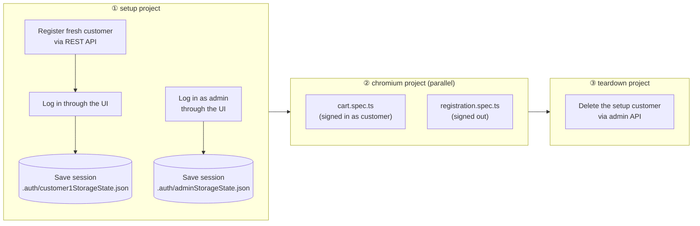
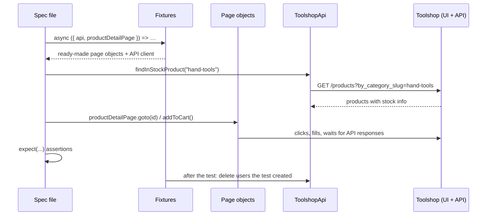
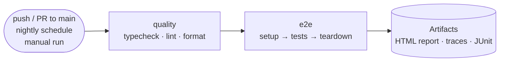

# Toolshop E2E Test Framework

[](https://github.com/hathihuyen/ecom-test-project-playwright/actions/workflows/playwright.yml)


End-to-end test automation for the [Practice Software Testing – Toolshop](https://practicesoftwaretesting.com), a demo e-commerce web shop, built with **Playwright** and **TypeScript**.

The framework tests the **UI** like a real customer would. It uses the shop's **REST API** to prepare and clean up test data quickly and reliably. Each test run creates its own user accounts and data and deletes them afterwards. Shared demo accounts, product stock or leftover state from earlier runs can't make it fail.

---

## Table of contents

1. [Highlights](#highlights)
2. [Tech stack](#tech-stack)
3. [Quick start](#quick-start)
4. [Running tests](#running-tests)
5. [How it works](#how-it-works)
6. [Project structure](#project-structure)
7. [Architecture & design decisions](#architecture--design-decisions)
8. [Test coverage](#test-coverage)
9. [Writing a new test](#writing-a-new-test)
10. [Conventions](#conventions)
11. [Reports & debugging](#reports--debugging)
12. [Continuous integration](#continuous-integration)
13. [Configuration reference](#configuration-reference)
14. [Troubleshooting](#troubleshooting)
15. [Roadmap](#roadmap)

---

## Highlights

|                                    |                                                                                                                       |
| ---------------------------------- | --------------------------------------------------------------------------------------------------------------------- |
| **Page Object Model + components** | Pages hold locators and user actions. Shared UI such as the nav bar is a reusable component.                          |
| **Custom fixtures**                | Tests ask for `registrationPage`, `api` and so on, and get ready-to-use objects. Nothing needs `new` inside a test.   |
| **API-first test data**            | Users are created through the REST API in about a second. The UI is used only for the behaviour under test.           |
| **Self-cleaning**                  | Every user a test creates is deleted afterwards, by a fixture or by a teardown project.                               |
| **Login once, reuse everywhere**   | A `setup` project logs in once and saves the session. All tests start already signed in.                              |
| **Isolated runs**                  | Each run uses a fresh customer account, so lockouts and database resets on the shared demo site can't break it.       |
| **Resilient to live data**         | Products are chosen at runtime by asking the API what is in stock. No hard-coded ids or names.                        |
| **Typed end to end**               | Strict TypeScript, a shared `User` model, typed page objects and typed environment config.                            |
| **Tag-based suites**               | `@smoke`, `@regression` and `@stress` let you run exactly the subset you need.                                        |
| **Quality gates**                  | Type check, ESLint (including Playwright rules and missing-`await` detection) and Prettier run in CI before any test. |
| **Rich failure evidence**          | Each failed test keeps a trace, a video and a screenshot. CI also writes JUnit results and GitHub annotations.        |

---

## Tech stack

| Tool                                                                                                                                                                            | Purpose                                                |
| ------------------------------------------------------------------------------------------------------------------------------------------------------------------------------- | ------------------------------------------------------ |
| [Playwright Test](https://playwright.dev)                                                                                                                                       | Test runner, browser automation, API requests, tracing |
| [TypeScript](https://www.typescriptlang.org)                                                                                                                                    | Static typing (strict mode), path aliases              |
| [Faker.js](https://fakerjs.dev)                                                                                                                                                 | Realistic random test data                             |
| [dotenv](https://github.com/motdotla/dotenv)                                                                                                                                    | Loads `.env` files per environment                     |
| [ESLint](https://eslint.org) + [typescript-eslint](https://typescript-eslint.io) + [eslint-plugin-playwright](https://github.com/playwright-community/eslint-plugin-playwright) | Static analysis and Playwright best practices          |
| [Prettier](https://prettier.io)                                                                                                                                                 | Consistent code formatting                             |
| [GitHub Actions](https://docs.github.com/actions)                                                                                                                               | CI pipeline                                            |

---

## Quick start

### Prerequisites

- **Node.js 22+**. The version is pinned in [`.nvmrc`](.nvmrc); with nvm, run `nvm use`.
- **Git**
- Admin credentials for the Toolshop demo site. They're published in the [Toolshop documentation](https://testsmith-io.github.io/practice-software-testing/#/).

### 1. Install

```bash
git clone https://github.com/hathihuyen/ecom-test-project-playwright.git
cd ecom-test-project-playwright
npm ci                                  # exact versions from package-lock.json
npx playwright install --with-deps chromium
```

### 2. Configure

```bash
cp .env.example .env
```

Then fill in `.env`:

```dotenv
BASE_URL=https://practicesoftwaretesting.com
API_URL=https://api.practicesoftwaretesting.com
ADMIN_EMAIL=<admin email>
ADMIN_PASSWORD=<admin password>
```

> `.env` is git-ignored and must never be committed. You don't need customer credentials, because the framework creates its own customer on every run.

### 3. Run

```bash
npm test               # full suite
npm run report         # open the HTML report
```

---

## Running tests

### npm scripts

| Command                           | What it does                                                    |
| --------------------------------- | --------------------------------------------------------------- |
| `npm test`                        | Run the full suite (setup → tests → teardown)                   |
| `npm run test:smoke`              | Only tests tagged `@smoke`, a fast confidence check             |
| `npm run test:regression`         | Only tests tagged `@regression`                                 |
| `npm run test:stress`             | The opt-in concurrency test (`@stress`), in its own project     |
| `npm run test:headed`             | Run with a visible browser window                               |
| `npm run test:ui`                 | Playwright **UI mode**: watch, time-travel, re-run single tests |
| `npm run test:debug`              | Step through a test with the Playwright Inspector               |
| `npm run report`                  | Open the last HTML report                                       |
| `npm run typecheck`               | TypeScript type check (`tsc --noEmit`)                          |
| `npm run lint` / `lint:fix`       | ESLint, optionally auto-fixing                                  |
| `npm run format` / `format:check` | Prettier write / verify                                         |

### Useful Playwright CLI options

```bash
npx playwright test tests/e2e/cart.spec.ts            # one file
npx playwright test -g "validation errors"            # tests whose title matches
npx playwright test --repeat-each=5                   # hunt for flaky tests
npx playwright test --project=setup                   # only the login setup
npx playwright test --list                            # list tests without running them
TEST_ENV=staging npx playwright test                  # use .env.staging (see Configuration)
ALL_BROWSERS=1 npx playwright test                    # add Firefox and WebKit projects
```

---

## How it works

### Test run lifecycle

Playwright **projects** are chained with dependencies, so every run follows the same lifecycle:



1. **`setup`** ([`tests/setup/auth.setup.ts`](tests/setup/auth.setup.ts)) runs first, once per run.
    - It **registers a brand-new customer through the API**, logs in through the real login form and saves the browser session (the auth token in `localStorage`) to `.auth/customer1StorageState.json`.
    - It logs in as the **admin** and saves that session too.
    - Logins use `LoginPage.loginAs()`. If the site rejects a login, the error contains the site's own message (for example _"Account locked…"_), not a generic timeout.
2. **`chromium`** runs the specs in parallel. Each test starts **already signed in as the customer**, because the project's `storageState` points at the saved session. Specs that need a signed-out browser (registration) override this with an empty storage state.
3. **`teardown`** ([`tests/setup/global.teardown.ts`](tests/setup/global.teardown.ts)) runs after all tests have finished and deletes the setup customer through the admin API.

### Inside a single test



- **Arrange** through the API: fast, and it doesn't depend on other screens working.
- **Act** through page objects: the same actions a real user takes.
- **Assert** with Playwright's web-first `expect`, which retries automatically until the condition is true or the timeout is reached.
- **Clean up** automatically in fixture teardown, even when the test fails.

---

## Project structure

```
.
├── .github/workflows/
│   └── playwright.yml          # CI: quality gate → E2E tests → reports
├── api/
│   └── toolshop.api.ts         # Typed REST client: register, login, find product, delete user
├── components/
│   └── header.component.ts     # Nav bar shared by every page (user menu, categories, cart badge)
├── config/
│   ├── auth.ts                 # Paths of saved sessions, admin display name
│   ├── env.ts                  # Loads .env / .env.<TEST_ENV>, validates required variables
│   ├── routes.ts               # App URLs in one place
│   └── timeouts.ts             # All timeouts as named constants
├── data/
│   ├── factory.ts              # Faker-based builders: createUser(), createUsers(), createInvalidUser()…
│   └── products.ts             # Static product references (only for stock-independent checks)
├── fixtures/
│   └── index.ts                # Custom `test` with page-object, API and cleanup fixtures
├── pages/
│   ├── base.page.ts            # Abstract base: holds `page` + `header`
│   ├── login.page.ts
│   ├── registration.page.ts
│   ├── product-list.page.ts
│   └── product-detail.page.ts
├── tests/
│   ├── setup/
│   │   ├── auth.setup.ts       # Creates customer + saves sessions (runs first)
│   │   └── global.teardown.ts  # Deletes the setup customer (runs last)
│   └── e2e/
│       ├── cart.spec.ts
│       ├── registration.spec.ts
│       └── concurrent-registration.spec.ts
├── types/
│   └── user.ts                 # Shared `User` model
├── .env.example                # Template of required environment variables
├── eslint.config.mjs           # ESLint flat config (TypeScript + Playwright rules)
├── .prettierrc.json            # Formatting rules
├── playwright.config.ts        # Projects, reporters, timeouts, artefacts
└── tsconfig.json               # Strict TS + path aliases
```

### Path aliases

Imports between folders use aliases defined in [`tsconfig.json`](tsconfig.json), so they never depend on how deep a file is:

```ts
import { test, expect } from "@fixtures";
import { createUser } from "@data/factory";
import { ROUTES } from "@config/routes";
```

| Alias           | Folder              |
| --------------- | ------------------- |
| `@fixtures`     | `fixtures/index.ts` |
| `@pages/*`      | `pages/*`           |
| `@components/*` | `components/*`      |
| `@api/*`        | `api/*`             |
| `@config/*`     | `config/*`          |
| `@data/*`       | `data/*`            |
| `@models/*`     | `types/*`           |

Imports inside the same folder stay relative, for example `./base.page`.

---

## Architecture & design decisions

The framework is built in layers. Each layer may only use the layers below it:

```
 Specs (tests/e2e)          what to test       — readable scenarios, tags, assertions
    │
 Fixtures (fixtures/)       wiring             — builds page objects / API client, cleans up
    │
 Page objects + components  how to do it (UI)  — locators and user actions
 API client                 how to do it (API) — data setup and cleanup
    │
 Config / data / types      shared foundations — env, routes, timeouts, factories, models
```

### Key decisions and why

| Decision                                                                                       | Why                                                                                                                                                                                                                                                                                                                              |
| ---------------------------------------------------------------------------------------------- | -------------------------------------------------------------------------------------------------------------------------------------------------------------------------------------------------------------------------------------------------------------------------------------------------------------------------------- |
| **Composition for the header** (`page.header.cartQuantity`) instead of inheriting nav locators | Every page _has_ a nav bar, but it isn't one. Shared UI lives in one component that any page can use.                                                                                                                                                                                                                            |
| **`page` is `protected` in page objects**                                                      | Tests can't bypass the page object with raw locators. A test that needs `page` (for example for `toHaveURL`) gets it from the fixture.                                                                                                                                                                                           |
| **Page objects return results, specs assert**                                                  | `registrationPage.register(user)` returns `{ status, userId }` and the spec decides what to expect. Page objects only wait for their own action to complete, for example `addToCart()` waits for the cart API call.                                                                                                              |
| **Fresh customer per run, created via API**                                                    | The public demo accounts get locked by other people's failed logins, and accounts you create by hand disappear when the demo database resets. A new account each run avoids both and starts with an empty cart.                                                                                                                  |
| **Products chosen at runtime** (`api.findInStockProduct`)                                      | Stock on the public shop changes all day and product ids change on every reset. Hard-coding either one makes tests flaky.                                                                                                                                                                                                        |
| **`route.fetch()` to capture the register response**                                           | The app redirects right after registering, and Chromium throws away the response body of the page it navigates away from. Intercepting the request with `page.route()` and making it through Playwright with `route.fetch()` keeps the body available. The page still receives the identical response through `route.fulfill()`. |
| **Cleanup in fixtures, not in `afterEach`**                                                    | `cleanupUsers` runs after every test that uses it, even a failed one, and only logs in as admin when there is something to delete.                                                                                                                                                                                               |
| **Environment getters that fail fast**                                                         | `env.adminEmail` throws _"Missing environment variable ADMIN_EMAIL…"_ the moment it is needed, instead of an `undefined` reaching a form field.                                                                                                                                                                                  |
| **No hard waits**                                                                              | There's no `waitForTimeout` anywhere. Waits are tied to real events (API responses, element states) through web-first assertions.                                                                                                                                                                                                |
| **`data-test` attributes as locators**                                                         | `testIdAttribute: "data-test"` matches the app's dedicated test hooks. These are stable across styling and copy changes.                                                                                                                                                                                                         |

---

## Test coverage

| Spec                                                                           | Test                                                                        | Tags                   | Session    |
| ------------------------------------------------------------------------------ | --------------------------------------------------------------------------- | ---------------------- | ---------- |
| [`cart.spec.ts`](tests/e2e/cart.spec.ts)                                       | Customer can add an in-stock product to the cart and the cart badge shows 1 | `@smoke` `@regression` | Customer   |
| [`registration.spec.ts`](tests/e2e/registration.spec.ts)                       | New user can register and is sent to the login page (API returns 201)       | `@smoke` `@regression` | Signed out |
| [`registration.spec.ts`](tests/e2e/registration.spec.ts)                       | Invalid data shows field-level validation errors                            | `@regression`          | Signed out |
| [`concurrent-registration.spec.ts`](tests/e2e/concurrent-registration.spec.ts) | Several users register at the same time in separate browser contexts        | `@stress`              | Signed out |

`@stress` tests are excluded from the default run and only run with `npm run test:stress`.

---

## Writing a new test

Example: **"a customer can open the contact page"**.

### 1. Add the route — [`config/routes.ts`](config/routes.ts)

```ts
export const ROUTES = {
    // …
    contact: "/contact",
} as const;
```

### 2. Create a page object — `pages/contact.page.ts`

```ts
import { Locator, Page } from "@playwright/test";
import { BasePage } from "./base.page";
import { ROUTES } from "@config/routes";

export class ContactPage extends BasePage {
    readonly firstNameInput: Locator;
    readonly sendButton: Locator;

    constructor(page: Page) {
        super(page);
        // Look up the real data-test ids in DevTools or with `npx playwright codegen`
        this.firstNameInput = page.getByTestId("first-name");
        this.sendButton = page.getByTestId("contact-submit");
    }

    async goto() {
        await this.page.goto(ROUTES.contact);
    }
}
```

### 3. Register it as a fixture — [`fixtures/index.ts`](fixtures/index.ts)

```ts
type Fixtures = {
    // …
    contactPage: ContactPage;
};

export const test = base.extend<Fixtures>({
    // …
    contactPage: async ({ page }, use) => {
        await use(new ContactPage(page));
    },
});
```

### 4. Write the spec — `tests/e2e/contact.spec.ts`

```ts
import { test, expect } from "@fixtures";

test.describe("Contact", () => {
    test("customer can open the contact form", { tag: "@regression" }, async ({ contactPage }) => {
        await contactPage.goto();
        await expect(contactPage.firstNameInput).toBeVisible();
    });
});
```

### 5. Verify

```bash
npm run typecheck && npm run lint
npx playwright test tests/e2e/contact.spec.ts --repeat-each=3
```

### Which session does my test get?

| Need                                | How                                                                          |
| ----------------------------------- | ---------------------------------------------------------------------------- |
| Signed in as **customer** (default) | Nothing to do                                                                |
| **Signed out**                      | `test.use({ storageState: { cookies: [], origins: [] } });`                  |
| Signed in as **admin**              | `test.use({ storageState: AUTH_FILES.admin });` (import from `@config/auth`) |

---

## Conventions

- **Locators:** prefer `getByTestId` (the `data-test` attribute), then `getByRole` / `getByLabel`. Avoid CSS and XPath.
- **No raw locators in specs.** If a spec needs an element, add it to the page object.
- **No hard waits** (`waitForTimeout`). Wait for a response, a URL or an element state.
- **No hard-coded live data.** Product ids and stock come from the API at runtime, and users come from the factory.
- **Every test cleans up** what it creates. Push created user ids into `cleanupUsers`.
- **Every test has a tag.** Use `@smoke` for critical paths, `@regression` for full coverage and `@stress` for opt-in load-style tests.
- **Test titles describe behaviour:** _"customer can add a product to the cart"_, not _"test cart 1"_.
- **Magic numbers go in `config/`:** timeouts in `timeouts.ts`, URLs in `routes.ts`.
- **Commit only green code:** `npm run typecheck && npm run lint && npm run format:check && npm test`.

---

## Reports & debugging

### Artefacts on failure

| Artefact                                           | When         | Where                                            |
| -------------------------------------------------- | ------------ | ------------------------------------------------ |
| HTML report                                        | Every run    | `playwright-report/`, open with `npm run report` |
| Trace (DOM snapshots, network, console, timeline)  | Failed tests | `test-results/<test>/trace.zip`                  |
| Video                                              | Failed tests | `test-results/<test>/video.webm`                 |
| Screenshot                                         | Failed tests | `test-results/<test>/test-failed-1.png`          |
| AI-friendly error context (page snapshot + source) | Failed tests | `test-results/<test>/error-context.md`           |
| JUnit XML                                          | CI only      | `test-results/junit.xml`                         |

### Debugging workflow

1. `npm run report`, click the failed test and open the **Trace** tab.
2. In the trace viewer, check the **Network** tab first: an unexpected `4xx` or `5xx` usually explains the failure. For example, `401` means bad credentials, `422` means invalid request data and `423` means a locked account.
3. Re-run just that test in UI mode: `npm run test:ui`.
4. Step through it: `npx playwright test <file> -g "<title>" --debug`.

The HTML report never opens automatically (`open: "never"`), so a run always exits on its own. Open the report with `npm run report` and stop it with `Ctrl+C`.

---

## Continuous integration

The pipeline is defined in [`.github/workflows/playwright.yml`](.github/workflows/playwright.yml).



| Trigger                       | Browsers                  | Notes                      |
| ----------------------------- | ------------------------- | -------------------------- |
| Push / pull request to `main` | Chromium                  | Required check             |
| Nightly schedule (weekdays)   | Chromium, Firefox, WebKit | Sets `ALL_BROWSERS=1`      |
| Manual (`workflow_dispatch`)  | Chromium                  | Run from the _Actions_ tab |

**CI behaviour** (from [`playwright.config.ts`](playwright.config.ts) when `CI` is set):

- `retries: 2`, which absorbs the occasional hiccup of the public demo site
- `workers: 2`, kept low on purpose because the target is a shared public site behind Cloudflare
- `forbidOnly: true`, so a forgotten `test.only` fails the build
- Reporters: `github` (inline annotations on the PR), `html` and `junit`
- A newer push to the same branch cancels the run still in progress (`concurrency`)

### Required repository settings

_Settings → Secrets and variables → Actions_

| Name             | Type     | Value                                                                 |
| ---------------- | -------- | --------------------------------------------------------------------- |
| `ADMIN_EMAIL`    | Secret   | Admin account email                                                   |
| `ADMIN_PASSWORD` | Secret   | Admin account password                                                |
| `BASE_URL`       | Variable | `https://practicesoftwaretesting.com` (optional, this is the default) |

After a run, download **playwright-report** (and **test-results** when something failed) from the bottom of the run summary page.

---

## Configuration reference

### Environment variables

| Variable         | Required | Default                                   | Purpose                                                                                |
| ---------------- | -------- | ----------------------------------------- | -------------------------------------------------------------------------------------- |
| `BASE_URL`       | No       | `https://practicesoftwaretesting.com`     | Web app under test                                                                     |
| `API_URL`        | No       | `https://api.practicesoftwaretesting.com` | REST API used for setup and cleanup                                                    |
| `ADMIN_EMAIL`    | **Yes**  | —                                         | Admin login (setup + user cleanup)                                                     |
| `ADMIN_PASSWORD` | **Yes**  | —                                         | Admin login                                                                            |
| `TEST_ENV`       | No       | —                                         | Loads `.env.<TEST_ENV>` before `.env`, for example `TEST_ENV=staging` → `.env.staging` |
| `STRESS`         | No       | —                                         | Adds the `stress` project                                                              |
| `ALL_BROWSERS`   | No       | —                                         | Adds the `firefox` and `webkit` projects                                               |
| `CI`             | No       | —                                         | Set automatically by GitHub Actions; switches to CI behaviour                          |

Precedence is: **real environment variables > `.env.<TEST_ENV>` > `.env` > defaults.**

### Timeouts — [`config/timeouts.ts`](config/timeouts.ts)

| Name         | Value | Applies to                                           |
| ------------ | ----- | ---------------------------------------------------- |
| `test`       | 30 s  | Whole test                                           |
| `expect`     | 5 s   | Each web-first assertion                             |
| `action`     | 10 s  | Each click, fill and so on                           |
| `navigation` | 15 s  | `page.goto` and navigations                          |
| `toast`      | 10 s  | Waiting for the "added to cart" message to disappear |

### Playwright projects

| Project                                | Runs                        | Depends on                      | Default session |
| -------------------------------------- | --------------------------- | ------------------------------- | --------------- |
| `setup`                                | `*.setup.ts`                | —                               | none            |
| `teardown`                             | `*.teardown.ts`             | runs after `setup`'s dependants | none            |
| `chromium`                             | everything except `@stress` | `setup`                         | customer        |
| `stress` _(STRESS=1)_                  | only `@stress`              | —                               | none            |
| `firefox`, `webkit` _(ALL_BROWSERS=1)_ | everything except `@stress` | `setup`                         | customer        |

---

## Troubleshooting

| Symptom                                                                  | Cause                                                                                | Fix                                                                                                                 |
| ------------------------------------------------------------------------ | ------------------------------------------------------------------------------------ | ------------------------------------------------------------------------------------------------------------------- |
| `Login failed for …: Account locked, too many failed attempts`           | Shared demo account locked by other users                                            | Only affects fixed accounts. The setup customer is fresh every run. For admin, wait for the demo site's next reset. |
| `Login failed for …: Invalid email or password`                          | Wrong `.env` values, or the account was removed by a demo reset                      | Check `.env`. Accounts created by visitors don't survive resets.                                                    |
| `Missing environment variable "ADMIN_EMAIL"`                             | `.env` not created, or a CI secret is missing                                        | `cp .env.example .env` and fill it in, or add the repository secret                                                 |
| `Register failed: {"email":["The email field is required."]}` (HTTP 422) | Request body is missing a field                                                      | Always register through `api.registerUser(user)`, which builds the typed body                                       |
| Add-to-cart button disabled / click timeout                              | Product is out of stock on the live site                                             | Pick products with `api.findInStockProduct()`, never by fixed name or id                                            |
| `response.json: No resource with given identifier found`                 | Reading a response body after the page navigated away                                | Capture it with `page.route` + `route.fetch()`, as in `RegistrationPage.register()`                                 |
| `project 'setup' has unknown teardown project 'teardown'`                | `teardown` project missing from config                                               | Keep the `teardown` project defined in `playwright.config.ts`                                                       |
| Terminal stuck after a run, `Ctrl+C` seems ignored                       | An HTML report server is still running, or VS Code used `Ctrl+C` to copy a selection | Click in the terminal to clear the selection, press `Ctrl+C` again, or close the terminal                           |
| Imports with `@pages/…` show red in VS Code                              | Editor hasn't reloaded `tsconfig.json`                                               | _Ctrl+Shift+P → "TypeScript: Restart TS Server"_                                                                    |

---

## Roadmap

- [ ] API test suite (`tests/api/`) for contract checks of `/products`, `/carts` and `/users`
- [ ] Checkout flow: cart → address → payment → invoice
- [ ] Admin scenarios (product and order management) using the saved admin session
- [ ] Visual regression snapshots for key pages
- [ ] Accessibility checks with `@axe-core/playwright`
- [ ] Sharded CI runs with a merged blob report once the suite grows
